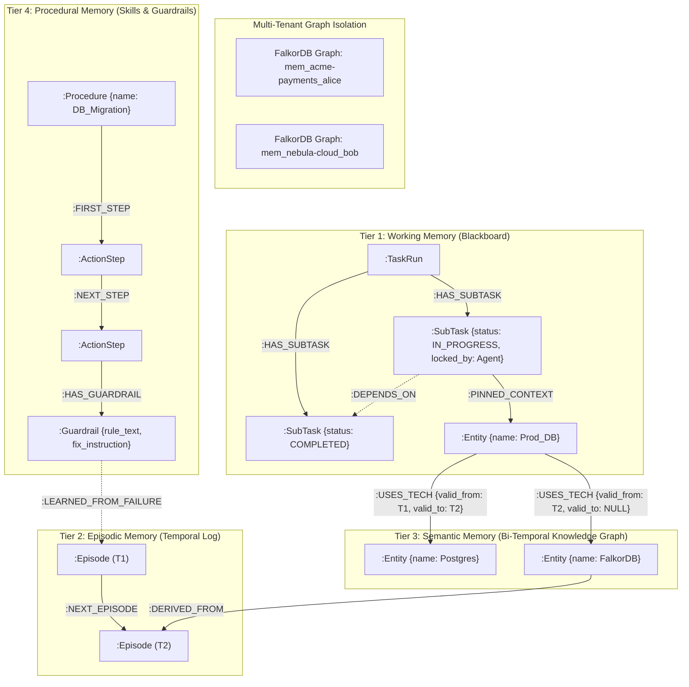

# AegisGraph

**Multi-Tenant 4-Tier Cognitive Graph Memory & Multi-Agent Coordination Engine**

Built for **Graph Hacks: Context for AI Agents (Powered by FalkorDB)**  
* **Primary Track:** Track 02: Agent Memory and Coordination  
* **Secondary Track:** Track 01: Agents That Act on Connected Data  

---

## 1. Executive Summary & Product Vision

Standard LLM agents suffer from context amnesia, race conditions during multi-agent handoffs, and an inability to learn from operational failures across sessions. Vector-only RAG memory fails because it treats memory as flat, timeless text chunks rather than evolving, causal relationships.

**AegisGraph** is a two-part cognitive platform built on **FalkorDB**:

1. **The Core Memory Engine:** A 4-tier cognitive graph architecture implementing **Working, Episodic, Semantic, and Procedural memory** with hardware-level multi-tenant graph isolation, bi-temporal conflict resolution, and atomic multi-agent blackboard coordination.
2. **The Showcase Control Plane:** An interactive multi-tenant web platform where users can switch tenants and users, watch multiple agents coordinate over shared graph state in real time, inspect live OpenCypher mutations, and verify cross-session procedural learning.

---

## 2. Theoretical Foundation & Research Citations

Every architectural mechanism in AegisGraph directly implements principles from peer-reviewed cognitive agent memory research:

| Memory Layer / Concept | Cited Research Paper | Core Mechanism Adopted in Our FalkorDB Engine |
| --- | --- | --- |
| **Overall 4-Tier Taxonomy** | **CoALA:** *Cognitive Architectures for Language Agents* (Sumers et al., Princeton, 2023 – `arXiv:2309.02427`) | Separates internal agent state into Working, Episodic, Semantic, and Procedural memory modules with structured `retrieve`, `reason`, and `write` actions. |
| **Graph Memory Loops** | *Graph-based Agent Memory: Taxonomy, Techniques, and Applications* (Yang et al., 2026 – `arXiv:2602.05665`) | Implements the dual-stream evolution loop: **Fast Stream** (real-time ingestion during turns) and **Slow Stream** (background graph consolidation & pruning). |
| **Working Memory** | **MemGPT:** *Towards LLMs as Operating Systems* (Packer et al., UC Berkeley, 2023 – `arXiv:2310.08560`) | Treats active context as OS RAM with explicit graph pointers (`[:PINNED_CONTEXT]`) and self-directed memory syscalls (`working_memory_pin`, `working_memory_evict`). |
| **Episodic Memory** | **Zep / Graphiti:** *A Temporal Knowledge Graph Architecture for Agent Memory* (Rasmussen et al., 2025 – `arXiv:2501.13956`) | **Bi-Temporal Graph Modeling:** Tracks both transaction time and validity windows (`valid_from`, `valid_to`) on edges so contradictions invalidate old facts without deleting audit history. |
| **Episodic Scoring & Reflection** | **Generative Agents:** *Interactive Simulacra of Human Behavior* (Park et al., Stanford, 2023 – `arXiv:2304.03442`) | Scores retrieved memories via hybrid graph + vector weighting: $S = \alpha \cdot \text{Recency} + \beta \cdot \text{Importance} + \gamma \cdot \text{Relevance}$, plus periodic synthesis into higher-order abstractions. |
| **Semantic Memory** | **HippoRAG:** *Neurobiologically Inspired Long-Term Memory for LLMs* (Gutiérrez et al., OSU, 2024 – `arXiv:2405.14831`) | Uses vector search strictly to locate **entry seed nodes**, then executes multi-hop Cypher neighborhood traversal to assemble connected relational context. |
| **Semantic Conflict Resolution** | **Mem0:** *Building Production-Ready AI Agents with Scalable Long-Term Memory* (Chhikara et al., 2025 – `arXiv:2504.19413`) | Distillation-first pipeline using deterministic state transitions (`ADD`, `SUPERSEDE`, `NOOP`) when incoming episodic triples conflict with existing semantic edges. |
| **Procedural Memory** | **Voyager** (*Wang et al., 2023 – `arXiv:2305.16291`*) & **Reflexion** (*Shinn et al., 2023 – `arXiv:2303.11366`*) | Stores reusable action workflows as executable DAGs (`:Procedure` $\rightarrow$ `:ActionStep`) and converts episodic execution failures into persistent `:Guardrail` edges. |
| **Dynamic Thresholding** | **vCache:** *Verified Semantic Prompt Caching* (Schroeder et al., UC Berkeley / Stanford / TU Munich, ICLR 2026 – `arXiv:2502.03771`) | Adapts per-node decision thresholds $\hat{\tau}_i$ after creation via runtime verification feedback loops, preventing stale or inaccurate memory reuse. |
| **Post-Creation Value Calibration** | **MemRL:** *Self-Evolving Agents via Runtime Reinforcement Learning on Memory* (Jan 2026 – `arXiv:2601.03192`) | Updates runtime utility/Q-values $Q(m_i)$ of memory nodes post-execution via temporal-difference learning based on task success ($r=+1$) or failure ($r=-1$). |
| **Recall Reinforcement** | **MemoryBank:** *Enhancing Large Language Models with Long-Term Memory* (Zhong et al., AAAI 2024 – `arXiv:2305.10250`) | Implements Ebbinghaus forgetting with post-creation recall reinforcement: accessing a node resets its recency and boosts its retrieval strength $S \leftarrow S + 1$. |

---

## 3. Architecture & Data Model



### Color Coding Scheme:
- **Yellow:** Working Memory (`:TaskRun`, `:SubTask`)
- **Blue:** Episodic Memory (`:Episode`)
- **Green:** Semantic Memory (`:Entity`, `:Fact`)
  - Solid edges: Active beliefs (`valid_to IS NULL`)
  - Dashed red edges: Superseded historical beliefs (`valid_to IS NOT NULL`)
- **Purple:** Procedural Memory (`:Procedure`, `:ActionStep`, `:Guardrail`)

---

## 4. Key OpenCypher Algorithms

All agent actions execute explicit, parameterized OpenCypher queries against FalkorDB:

### 4.1 Bi-Temporal Invalidation & Upsert
```cypher
MATCH (s:Entity {name: $subject})-[old_r:RELATES_TO {predicate: $predicate}]->(old_o:Entity)
WHERE old_r.valid_to IS NULL AND old_o.name <> $new_object
SET old_r.valid_to = $now, old_r.invalidated_by_episode = $episode_id
WITH count(old_r) AS invalidated_count
MERGE (s:Entity {name: $subject})
MERGE (new_o:Entity {name: $new_object})
MERGE (ep:Episode {id: $episode_id})
CREATE (s)-[new_r:RELATES_TO {
    predicate: $predicate,
    valid_from: $now,
    valid_to: NULL,
    confidence: $confidence,
    source_episode: $episode_id
}]->(new_o)
CREATE (new_o)-[:DERIVED_FROM]->(ep)
RETURN invalidated_count, new_r
```

### 4.2 Atomic Multi-Agent SubTask Claim
```cypher
MATCH (t:TaskRun {id: $task_id})-[:HAS_SUBTASK]->(st:SubTask {status: 'PENDING'})
WHERE NOT (st)-[:DEPENDS_ON]->(:SubTask {status: 'PENDING'})
  AND NOT (st)-[:DEPENDS_ON]->(:SubTask {status: 'IN_PROGRESS'})
WITH st LIMIT 1
SET st.status = 'IN_PROGRESS',

    st.locked_by = $agent_id,
    st.claimed_at = $now
WITH st
OPTIONAL MATCH (st)-[:DEPENDS_ON]->(parent:SubTask)-[:PINNED_CONTEXT]->(ctx)
RETURN st, collect(ctx) AS inherited_context_nodes
```

### 4.3 Dynamic Score Adaptation & Feedback Loop (vCache + MemRL)
```cypher
MATCH (st:SubTask {id: $subtask_id})-[:PINNED_CONTEXT]->(m)
SET m.access_count = coalesce(m.access_count, 0) + 1,
    m.last_accessed = $now,
    m.utility_score = coalesce(m.utility_score, m.importance_score, 0.5) + $alpha * ($reward - coalesce(m.utility_score, m.importance_score, 0.5)),
    m.vcache_threshold = CASE
        WHEN $reward > 0 THEN coalesce(m.vcache_threshold, 0.78) - 0.02
        ELSE coalesce(m.vcache_threshold, 0.78) + 0.05
    END
RETURN m.id AS id, m.utility_score AS new_utility, m.vcache_threshold AS new_threshold
```

---

## 5. Quickstart Guide

### Option 1: One-Click Docker Compose
```bash
# Clone and enter repo
git clone https://github.com/RitwikGupta-0501/agentic-memory.git
cd agentic-memory

# Copy environment variables
cp .env.example .env

# Start FalkorDB and FastAPI backend
docker compose up --build
```
- FalkorDB Web Console: `http://localhost:3000`
- FastAPI Interactive API Docs: `http://localhost:8000/docs`

### Option 2: Local Development with `uv`
```bash
# 1. Start FalkorDB
docker compose up -d falkordb

# 2. Run Backend
cd backend
uv sync
uv run uvicorn app.main:app --host 0.0.0.0 --port 8000 --reload
```

---

## 6. AI Coding Assistant Disclosure

In compliance with **Hackathon Rule #11**, this repository leveraged AI pair programming tools (including Google DeepMind Antigravity) for architectural design ideation, boilerplate generation, and verification test scripting. All OpenCypher graph modeling, bi-temporal graph query designs, multi-tenant partitioning, and blackboard concurrency mechanisms were engineered and validated directly against FalkorDB.
