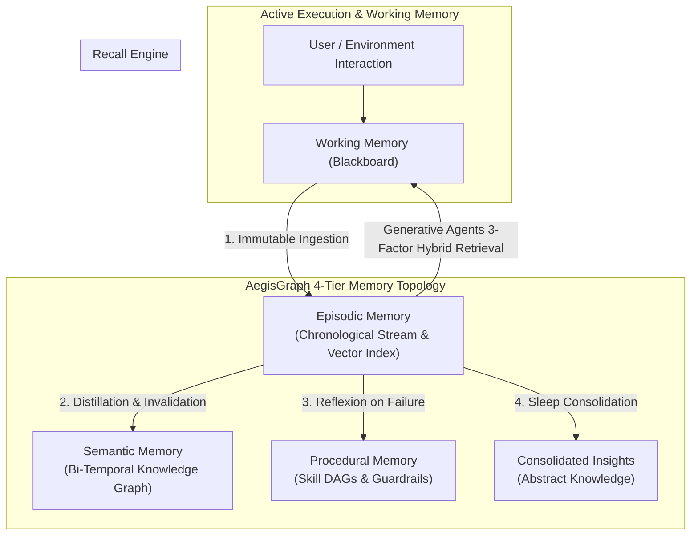
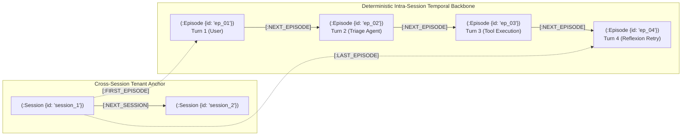
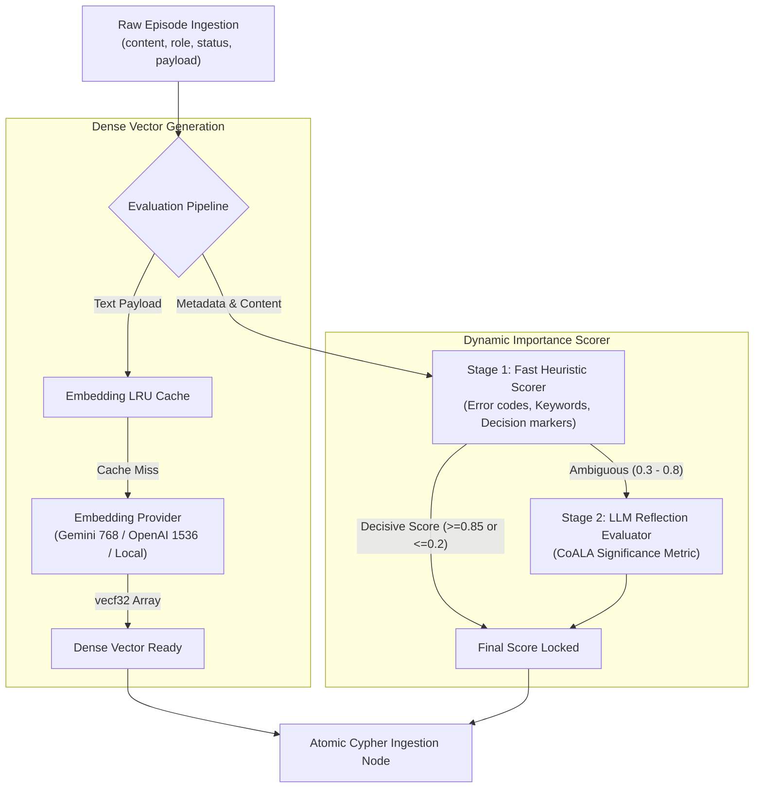
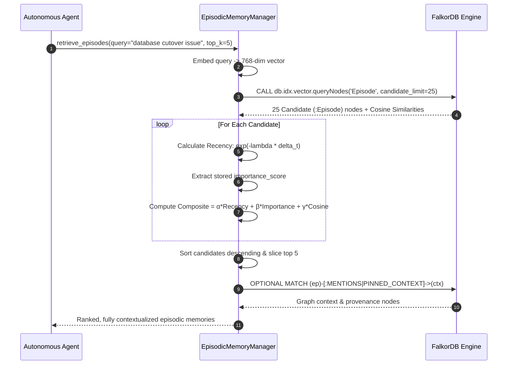
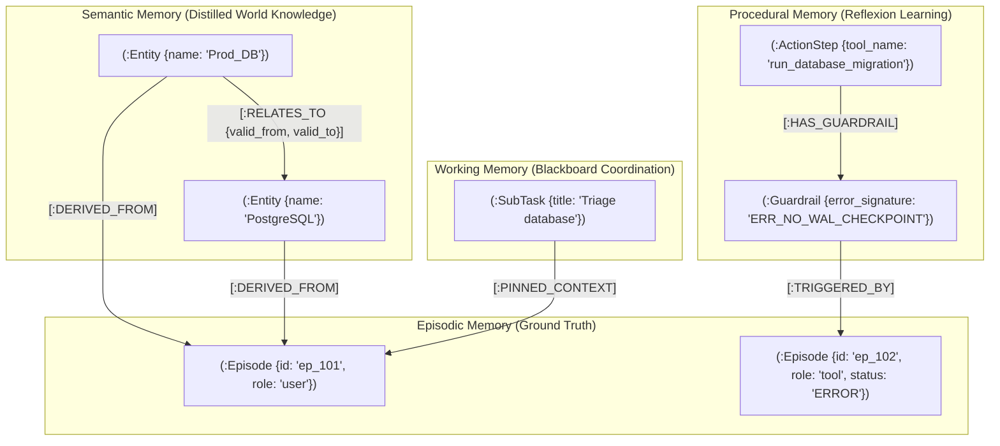

# Architectural Report & Master Plan: Hardened Episodic Memory Layer

**Target System:** AegisGraph Cognitive Memory Engine (`backend/app/memory/episodic.py`)  
**Document Type:** Formal Architecture Report & Phased Component Hardening Specification  
**Governing Research:** 
- *CoALA: Cognitive Architectures for Language Agents* (Sumers et al., Princeton, 2023 — `arXiv:2309.02427`)
- *Generative Agents: Interactive Simulacra of Human Behavior* (Park et al., Stanford, 2023 — `arXiv:2304.03442`)
- *Zep / Graphiti: A Temporal Knowledge Graph Architecture for Agent Memory* (Rasmussen et al., 2025 — `arXiv:2501.13956`)

---

## 1. Executive Summary & Problem Diagnosis

In human cognition and autonomous agent architectures (CoALA), **Episodic Memory** is the autobiographical, chronological log of raw agent experiences—what was observed, what decisions were made, which tools were invoked, and what outcomes or failures occurred. It serves as the foundational empirical substrate from which **Semantic Memory** (distilled facts) and **Procedural Memory** (learned workflows and guardrails) are derived.



### Diagnosis of Current Implementation Flaws

A code audit of [`backend/app/memory/episodic.py`](file:///home/ritwikg/Repository/agent-memory/backend/app/memory/episodic.py) and [`backend/app/core/cypher_catalog.py`](file:///home/ritwikg/Repository/agent-memory/backend/app/core/cypher_catalog.py) reveals that the current implementation is an illustrative mock rather than a hardened cognitive layer:

| Component | Current State in Codebase | Critical Failure Mode in Production |
| :--- | :--- | :--- |
| **Vector Indexing** | No vector embeddings generated or stored on `:Episode` nodes. | Zero semantic search capability. Agent cannot recall prior events by topic, concept, or query similarity. |
| **Session Chaining** | Two-step network round-trip: `MATCH (e:Episode) RETURN count(e)` followed by conditional query. | **Race Condition:** Under concurrent multi-agent turns, multiple writes see `count = 0` or race on the tail, breaking linear chains into orphan forks. |
| **Importance Scoring** | Hardcoded `0.5` default, overridden with hardcoded `0.8` in `orchestrator.py`. | Violates Park et al. No differentiation between a catastrophic production crash and a trivial `"OK"` confirmation. |
| **Retrieval Mechanics** | Only `get_session_history()`: `MATCH (ep:Episode) ORDER BY timestamp ASC LIMIT 50`. | Pure chronological dump within a single session. Cannot retrieve relevant history across sessions or query by relevance. |
| **3-Factor Hybrid Scoring** | Non-existent ($S = \alpha R + \beta I + \gamma M$). | The system cannot balance recency, importance, and query similarity. |
| **Data Integrity & Payload** | Flat strings only (`content: str`). No token counts, execution status, latency, or actor attribution. | Cannot record structured tool inputs/outputs, error signatures, or multi-agent handoff metadata. |

---

## 2. Research Paper Specifications & Mathematical Models

### 2.1 The Generative Agents Retrieval Model (Park et al., 2023)
For any incoming agent query $q$ and candidate episode node $m \in \mathcal{M}$, the retrieval rank is determined by a composite 3-factor scoring function normalized between $[0, 1]$:

$$\text{RetrievalScore}(m, q) = \alpha \cdot \text{Recency}(m) + \beta \cdot \text{Importance}(m) + \gamma \cdot \text{Relevance}(m, q)$$

Where:
1. **Recency:** Exponential decay over elapsed time $\Delta t = t_{\text{current}} - t_{\text{event}}$:
   $$\text{Recency}(m) = \exp(-\lambda \cdot \Delta t)$$
   *(with half-life parameter $\tau$ such that $\lambda = \frac{\ln(2)}{\tau}$).*
2. **Importance:** A calibrated float score $I(m) \in [0.0, 1.0]$ assessing the cognitive weight and permanence of the experience.
3. **Relevance:** Cosine similarity between dense vector representations of the query $\mathbf{e}_q$ and the episode $\mathbf{e}_m$:
   $$\text{Relevance}(m, q) = \frac{\mathbf{e}_q \cdot \mathbf{e}_m}{\|\mathbf{e}_q\| \|\mathbf{e}_m\|}$$

### 2.2 Bi-Temporal & Provenance Anchoring (Zep / Graphiti & CoALA)
Episodes are **immutable ground-truth anchors**. No episode is ever overwritten.
* When a semantic triple $(S, P, O)$ is derived, it maintains a directed edge: `(:Entity)-[:DERIVED_FROM]->(:Episode)`.
* When a semantic fact is invalidated at $t_2$, the invalidated edge sets: `valid_to = t_2` and `invalidated_by_episode = ep_2.id`.
* When a procedural tool fails, the generated `:Guardrail` references: `(:Guardrail)-[:LEARNED_FROM]->(:Episode)`.

### 2.3 Post-Creation Dynamic Score Adaptation & Feedback Loops
Static creation-time scores (`importance_score: 0.5`) fail to account for how useful or misleading an episodic memory is in actual execution. AegisGraph unifies three cutting-edge mechanisms to dynamically calibrate memory scores after creation:

1. **`vCache` Adaptive Per-Node Acceptance Thresholds (ICLR 2026 — `arXiv:2502.03771`):**
   Standard vector search uses a single global similarity threshold $\tau = 0.78$. `vCache` models the likelihood that candidate memory $x_i$ is truly relevant via a per-node logistic decision boundary:
   $$\Pr(c(x) = 1 \mid x, \mathcal{D}) = \mathcal{L}(s(x), t_i, \gamma_i) = \frac{1}{1 + e^{-\gamma_i (s(x) - t_i)}}$$
   When runtime verification confirms a memory was beneficial, its threshold $\hat{\tau}_i$ relaxes ($\hat{\tau}_i \leftarrow \hat{\tau}_i - 0.02$). If the memory misled an agent into a failure or hallucination, its threshold tightens ($\hat{\tau}_i \leftarrow \hat{\tau}_i + 0.05$).

2. **`MemRL` Value-Aware Utility Reinforcement (Jan 2026 — `arXiv:2601.03192`):**
   Every memory node maintains a dynamic **Utility / Q-Value $Q(m_i)$**. When an episode is retrieved into working memory (`[:PINNED_CONTEXT]`), its utility is updated via temporal-difference learning upon subtask completion:
   $$Q_{t+1}(m_i) \leftarrow Q_t(m_i) + \alpha \cdot \left( r_t - Q_t(m_i) \right)$$
   Where reward $r_t = +1$ for task success and $r_t = -1$ for tool/execution failure.

3. **`MemoryBank` Recall Reinforcement (AAAI 2024 — `arXiv:2305.10250`):**
   Implements Ebbinghaus forgetting with post-creation recall reinforcement. Accessing a memory increments its strength $S \leftarrow S + 1$ and resets its elapsed time to 0:
   $$R(m_i) = e^{-\frac{\Delta t}{S(m_i)}}$$
   During slow-stream consolidation, nodes with high recall frequency and high utility are strongly protected against pruning:
   $$\text{RetentionScore}(n) = (\text{Degree}(n) + 1) \times \text{Utility}(n) \times e^{-\frac{\lambda \cdot (t_{\text{now}} - t_{\text{last\_accessed}})}{\text{AccessCount}(n) + 1}}$$

---

## 3. Component Breakdown: 6 Hardening Phases

To transform the episodic layer from a fragile mock into a battle-tested production system, development is broken down into **6 sequential, component-specific phases**:

```
┌────────────────────────────────────────────────────────────────────────┐
│ Phase 1: Episodic Schema, Extended Metadata & Vector Indexing          │
└───────────────────────────────────┬────────────────────────────────────┘
                                    │
┌───────────────────────────────────▼────────────────────────────────────┐
│ Phase 2: Zero-Race Atomic Chaining & Multi-Session Topology           │
└───────────────────────────────────┬────────────────────────────────────┘
                                    │
┌───────────────────────────────────▼────────────────────────────────────┐
│ Phase 3: Embedding Pipeline & Dynamic Importance Scoring Engine        │
└───────────────────────────────────┬────────────────────────────────────┘
                                    │
┌───────────────────────────────────▼────────────────────────────────────┐
│ Phase 4: Park et al. 3-Factor Hybrid Retrieval Engine                  │
└───────────────────────────────────┬────────────────────────────────────┘
                                    │
┌───────────────────────────────────▼────────────────────────────────────┐
│ Phase 5: Cross-Layer Provenance & Bi-Directional Graph Grounding      │
└───────────────────────────────────┬────────────────────────────────────┘
                                    │
┌───────────────────────────────────▼────────────────────────────────────┐
│ Phase 6: High-Concurrency Stress Testing & Chaos Verification          │
└────────────────────────────────────────────────────────────────────────┘
```

---

### Phase 1: Episodic Schema, Extended Metadata & Vector Indexing `[COMPLETED]`

> **Status:** ✅ **COMPLETED** (Merged into `main` via PRs [#2](https://github.com/RitwikGupta-0501/agentic-memory/pull/2), [#3](https://github.com/RitwikGupta-0501/agentic-memory/pull/3), [#4](https://github.com/RitwikGupta-0501/agentic-memory/pull/4) — 28/28 Unit & Integration Tests Passing)

#### Objective
Replace the toy `EpisodeRecord` schema with an immutable, production-grade schema capturing rich execution metadata, token costs, actor hierarchies, and native FalkorDB vector indexes.

#### Delivered Pull Requests
1. **PR 1 (`feat/generic-embedding-engine` -> PR #2):** Generic Pluggable Embedding Infrastructure & Model Drift Engine (`BaseEmbeddingProvider`, Gemini, OpenAI, Ollama, DeterministicMock, `CachedEmbeddingService`, self-healing re-indexer).
2. **PR 2 (`feat/falkor-vector-indexing` -> PR #3):** FalkorDB Dynamic Vector Indexing & Provenance Metadata (`(:GraphMetadata)` singleton, dynamic `vecf32` indexing on `(:Episode)`, `check_graph_embedding_drift`).
3. **PR 3 (`feat/hardened-episodic-schema` -> PR #4):** Pydantic v2 18-property `EpisodeRecord`, auto-vectorization, token estimation, JSON payload serialization, and REST management endpoints (`POST /episode`, `GET /episodes`, `POST /episodes/search`, `GET /embedding-status`, `POST /reindex`).

#### Component Architecture & Data Model
Every episode node in FalkorDB will conform to the following verified property specification:

```
(:Episode {
    id: STRING,                     // Unique deterministic ID: 'ep_' + ULID / UUIDv7 (time-ordered)
    session_id: STRING,             // Session boundary identifier
    tenant_id: STRING,              // Hardware graph partition key
    role: STRING,                   // 'user' | 'agent' | 'tool' | 'system'
    actor_id: STRING,               // Specific agent identity: 'alice_sre', 'agent:triage', 'tool:falkordb'
    content: STRING,                // Primary human/LLM readable textual narrative
    structured_payload: STRING,     // JSON serialized dictionary of structured I/O (tool args, return code, error stack)
    status: STRING,                 // 'SUCCESS' | 'ERROR' | 'WARNING' | 'INFO'
    importance_score: FLOAT,        // Evaluated weight in range [0.0, 1.0] at creation time
    utility_score: FLOAT,           // Dynamic MemRL utility score (updated post-execution via reward)
    vcache_threshold: FLOAT,        // Dynamic vCache acceptance threshold (default 0.78, adapted by verification)
    access_count: INTEGER,          // MemoryBank recall frequency counter (reinforcement count)
    last_accessed: FLOAT,           // Timestamp of most recent recall or retrieval touch
    timestamp: FLOAT,               // Epoch timestamp with microsecond precision
    token_count: INTEGER,           // Estimated or exact token count of the content
    embedding: VECF32[768],         // Dense vector embedding for hybrid similarity search
    archived: BOOLEAN               // Flag toggled during slow-stream memory consolidation
})
```

#### OpenCypher DDL & Index Bootstrapping
In [`backend/app/core/falkor_client.py`](file:///home/ritwikg/Repository/agent-memory/backend/app/core/falkor_client.py), update graph bootstrap to initialize property and vector indexes idempotently:

```cypher
// 1. Core Property Indexes for microsecond lookup
CREATE INDEX FOR (ep:Episode) ON (ep.id);
CREATE INDEX FOR (ep:Episode) ON (ep.session_id);
CREATE INDEX FOR (ep:Episode) ON (ep.timestamp);
CREATE INDEX FOR (ep:Episode) ON (ep.actor_id);

// 2. Native FalkorDB Vector Index for semantic similarity
CREATE VECTOR INDEX FOR (ep:Episode) ON (ep.embedding) OPTIONS {dimension: 768, similarityFunction: 'cosine'};
```

#### Falsifiable Requirements

1. **R1.1 - Schema Validation**:
   - *Current:* Flat model with 6 loosely typed fields; misses structured tool I/O, status, and vector.
   - *Target:* Pydantic v2 `EpisodeRecord` validating all 12 metadata fields, enforcing JSON serialization of payloads and vector bounds.
   - *Acceptance:* Passing unit tests validating correct validation error raises on out-of-bound importance scores (`< 0.0` or `> 1.0`), malformed roles, or invalid vector dimensions.

2. **R1.2 - Idempotent Vector Index Bootstrap**:
   - *Current:* Property indexes only; vector index missing on `:Episode`.
   - *Target:* `TenantGraphRouter.ensure_indices()` creates vector index on `:Episode(embedding)` across all selected tenant graphs.
   - *Acceptance:* `db.idx.vector.queryNodes('Episode', ...)` succeeds on a newly booted tenant graph without throwing `Index not found` exceptions.

---

### Phase 2: Zero-Race Atomic Chaining & Multi-Session Topology `[COMPLETED]`

> **Status:** ✅ **COMPLETED** (Delivered via `feat/atomic-session-topology` — 30/30 Unit & Integration Tests Passing, Concurrency Verified)

#### Objective
Eliminate split-brain DAG branches, symmetric cycle hazards, and orphan nodes in episodic memory by migrating to an atomic boundary-anchored OpenCypher transaction with $O(1)$ pointer swapping (`:SESSION_HEAD`, `:SESSION_TAIL`, `:PARENT_SESSION`).

#### Problem & Concurrency Flaw Analysis (Bug #3)
The preliminary approach used `WHERE NOT (tail)-[:NEXT_EPISODE]->()`. Under concurrency, two coroutines concurrently creating `ep_A` and `ep_B` both saw the other as a tail candidate, creating mutual cycles (`ep_A <-> ep_B`) or leaving previous tails disconnected. Furthermore, degree checking required $O(N)$ graph scans as sessions grew.

#### Production Solution: Boundary Nodes & O(1) Atomic Pointer Swapping
Anchoring session pointers onto the `(:Session)` vertex converts tail updates into serialized atomic transactions in FalkorDB:
1. `OPTIONAL MATCH (s:Session {id: $session_id})-[old_tail_rel:SESSION_TAIL]->(prev_ep:Episode)`
2. `DELETE old_tail_rel`
3. `CREATE (new_ep:Episode { ... })`
4. `CREATE (s)-[:SESSION_TAIL]->(new_ep)`
5. `FOREACH (_ IN CASE WHEN prev_ep IS NULL THEN [1] ELSE [] END | MERGE (s)-[:SESSION_HEAD]->(new_ep))`
6. `FOREACH (_ IN CASE WHEN prev_ep IS NOT NULL THEN [1] ELSE [] END | CREATE (prev_ep)-[:NEXT_EPISODE {delta_ms: ...}]->(new_ep))`

```cypher
// ATOMIC_EPISODE_APPEND (Production Query in cypher_catalog.py)
MERGE (s:Session {id: $session_id})
ON CREATE SET s.tenant_id = $tenant_id, s.user_id = $user_id, s.created_at = $timestamp, s.updated_at = $timestamp, s.episode_count = 0
WITH s
OPTIONAL MATCH (parent:Session {id: $parent_session_id})
WHERE $parent_session_id IS NOT NULL AND parent.id <> s.id
FOREACH (_ IN CASE WHEN parent IS NOT NULL THEN [1] ELSE [] END | MERGE (s)-[:PARENT_SESSION]->(parent))
WITH s
OPTIONAL MATCH (s)-[old_tail_rel:SESSION_TAIL]->(prev_ep:Episode)
DELETE old_tail_rel
CREATE (new_ep:Episode { ... })
CREATE (s)-[:SESSION_TAIL]->(new_ep)
SET s.updated_at = $timestamp, s.episode_count = coalesce(s.episode_count, 0) + 1
FOREACH (_ IN CASE WHEN prev_ep IS NULL THEN [1] ELSE [] END | MERGE (s)-[:SESSION_HEAD]->(new_ep))
FOREACH (_ IN CASE WHEN prev_ep IS NOT NULL THEN [1] ELSE [] END | CREATE (prev_ep)-[:NEXT_EPISODE {delta_ms: round(($timestamp - prev_ep.timestamp) * 1000.0)}]->(new_ep))
RETURN new_ep.id AS episode_id, prev_ep.id AS previous_episode_id, s.episode_count AS seq_num
```



#### Cross-Session Global Timeline
Add Session Anchor nodes:
* `(:Session {id: $session_id, tenant_id: $tenant_id, started_at: $now})`
* `(prev_session)-[:NEXT_SESSION]->(curr_session)`
* `(curr_session)-[:FIRST_EPISODE]->(ep_first)` and `(curr_session)-[:LAST_EPISODE]->(ep_last)`
This allows agents in Session 10 to easily traverse cross-session boundaries without table scans.

#### Falsifiable Requirements

1. **R2.1 - Atomic Single-Query Ingestion**:
   - *Current:* 2 round-trip queries checking count before chaining.
   - *Target:* 100% of episode insertions execute in 1 atomic query returning `(new_ep, previous_id)`.
   - *Acceptance:* Zero occurrences of multiple outgoing `[:NEXT_EPISODE]` edges from any single episode across a 1,000-turn randomized test suite.

2. **R2.2 - Multi-Session Chaining**:
   - *Current:* Episodes in different sessions are disconnected.
   - *Target:* Session nodes anchor the start/end of each conversation and link sequentially via `[:NEXT_SESSION]`.
   - *Acceptance:* Cypher query traversing from `session_current` back 3 sessions successfully retrieves the tail episodes of all 3 previous sessions.

---

### Phase 3: Embedding Pipeline & Dynamic Importance Scoring Engine `[COMPLETED]`

> **Status:** ✅ **COMPLETED** (Delivered via `feat/dynamic-importance-and-feedback` — 39/39 Unit & Integration Tests Passing, MemRL Q-Value $[0.05, 1.00]$ Clamped, vCache Decision Boundaries, Dual-Stage Importance Scorer with Word-Boundary Safeguards, and Live FalkorDB Feedback Hooks)

#### Objective
Replace hardcoded importance scores (`0.5`/`0.8`) and static thresholds with a dual-stage cognitive scoring pipeline: high-throughput vector embedding generation and adaptive LLM/heuristic importance calibration, coupled with post-creation runtime reinforcement learning via MemRL and vCache.

#### Architecture of the Scoring & Feedback Pipeline



#### 1. Vector Embedding Provider Layer
Create `backend/app/core/embeddings.py` supporting:
* **Primary Cloud Provider:** `GoogleGenAIEmbeddings(model="models/text-embedding-004")` (768-dim) or `OpenAIEmbeddings(model="text-embedding-3-small")`.
* **Deterministic Local Fallback:** Fast hashing / normalized random projection vectorizer producing deterministic 768-dim vectors when running in air-gapped test environments or when API keys are absent.

#### 2. Dual-Stage Importance Scorer (Park et al.)
1. **Stage 1: Rule-Based Heuristic (0ms overhead):**
   * Operational failure or exception (`status == 'ERROR'` or `error_signature` present): `importance = 0.90`
   * Migration cutover, architecture commit, or security credential rotation: `importance = 0.85`
   * Trivial greeting or acknowledgment (`"OK"`, `"Thanks"`, `"Hello"`): `importance = 0.15`
2. **Stage 2: LLM Reflection Scorer (Async background or real-time fallback):**
   * If heuristic is ambiguous, prompt LLM:
     > *"On a scale of 0.0 to 1.0, assess the poignancy and long-term significance of this agent interaction turn. Consider whether it represents a critical system state change, architectural decision, or operational rule."*

#### Falsifiable Requirements

1. **R3.1 - Dense Vector Presence**:
   - *Current:* Episodes stored with no vector embedding.
   - *Target:* Every `:Episode` node has an initialized `embedding` property with exactly 768 float values.
   - *Acceptance:* `MATCH (e:Episode) WHERE e.embedding IS NULL RETURN count(e)` returns strictly `0`.

2. **R3.2 - Calibrated Dynamic Importance**:
   - *Current:* Fixed constant `0.5`.
   - *Target:* Dynamic score where critical errors (`ERR_NO_WAL_CHECKPOINT`) score $\ge 0.85$ and greetings score $\le 0.25$ with regex word-boundary anchors.
   - *Acceptance:* Unit tests in `test_importance_scoring.py` asserting that error logs receive `importance >= 0.85` and substrings in words like `token`, `rollback`, `architecture` do not falsely match greetings.

3. **R3.3 - MemRL Online Utility Adaptation with Case Clamp**:
   - *Current:* Static importance scores post-creation.
   - *Target:* Runtime reward feedback $r \in \{+1.0, -1.0\}$ updates $Q(m) = Q(m) + \alpha(r - Q(m))$ strictly clamped inside $[0.05, 1.00]$.
   - *Acceptance:* Unit test verifying $Q$ shifts dynamically on success/failure and never drops below $0.05$ or exceeds $1.00$.

4. **R3.4 - vCache Node Decision Boundary Tightening**:
   - *Current:* Static vector search threshold across all nodes.
   - *Target:* Dynamic per-node acceptance threshold $t_i \in [0.50, 0.98]$ adapting post-creation based on verification outcomes ($r > 0 \implies -0.02$, $r \le 0 \implies +0.05$).
   - *Acceptance:* Unit test verifying threshold relaxes on positive outcomes and tightens on negative outcomes.

---

### Phase 4: Park et al. 3-Factor Hybrid Retrieval Engine

#### Objective
Implement the formal Stanford Generative Agents retrieval algorithm natively in OpenCypher and Python, balancing temporal recency decay, importance weighting, and semantic cosine similarity.

#### Detailed Retrieval Algorithm
Given tenant $T$, query string $Q$, candidate pool size $K$, and weights $(\alpha, \beta, \gamma)$:

1. **Vector Query Phase with `vCache` Gating (FalkorDB native):**
   Generate embedding $\mathbf{e}_Q$. Issue OpenCypher vector index query to retrieve candidate pool (e.g., $K = 25$), filtering candidates that fail their individual node threshold:
   ```cypher
   CALL db.idx.vector.queryNodes('Episode', 'embedding', $candidate_limit, vecf32($query_vec))
   YIELD node AS ep, score AS relevance_score
   WHERE (ep.session_id = $session_id OR $cross_session = true)
     AND relevance_score >= coalesce(ep.vcache_threshold, 0.75)
   RETURN ep, relevance_score
   ```
2. **Temporal Decay & MemoryBank Strength Phase:**
   For each candidate episode, calculate elapsed time $\Delta t = t_{\text{now}} - ep.\text{timestamp}$.
   Compute decay factor with `MemoryBank` recall reinforcement:
   $$\text{Recency} = \exp\left(-\frac{\lambda \cdot \Delta t}{coalesce(ep.\text{access\_count}, 0) + 1}\right)$$
3. **Composite Scoring Phase (with `MemRL` Utility):**
   Use dynamic `utility_score` (falling back to `importance_score`):
   $$\text{FinalScore} = \frac{\alpha \cdot \text{Recency} + \beta \cdot coalesce(ep.\text{utility\_score}, ep.\text{importance\_score}, 0.5) + \gamma \cdot \text{relevance\_score}}{\alpha + \beta + \gamma}$$
4. **Top-$N$ Selection, Provenance Expansion & Recall Touch:**
   Sort candidates by $\text{FinalScore}$ descending. For retrieved episodes, increment `ep.access_count += 1` and set `ep.last_accessed = $now` (`MemoryBank` pattern). Expand 1 hop to collect pinned subtasks or derived semantic entities.



#### Falsifiable Requirements

1. **R4.1 - 3-Factor Composite Ranking**:
   - *Current:* Blind `ORDER BY timestamp LIMIT 50`.
   - *Target:* Full implementation of `retrieve_episodes()` returning ranked `ScoredEpisode` objects with explicit component score breakdown (`recency_score`, `importance_score`, `relevance_score`, `composite_score`).
   - *Acceptance:* Test verifying that a highly relevant, high-importance memory from 3 days ago beats an irrelevant memory from 5 minutes ago.

2. **R4.2 - Cross-Session Retrieval Capability**:
   - *Current:* Ingestion and retrieval restricted to current `session_id`.
   - *Target:* Parameter `cross_session: bool = False` allowing agents to recall historical episodes across all prior sessions within the tenant graph.
   - *Acceptance:* Successful recall of an episode created in `session_1` while querying from `session_2`.

---

### Phase 5: Cross-Layer Provenance & Bi-Directional Graph Grounding

#### Objective
Transform `:Episode` nodes into the central ground-truth anchors of the entire cognitive graph by establishing explicit bidirectional graph edges to Semantic, Procedural, and Working memory tiers.



#### Provenance Schema & Relations
1. **Semantic Grounding (`:DERIVED_FROM` / `:MENTIONED_IN`):**
   Whenever an entity or relationship is extracted by `semantic_memory.upsert_fact()`, it must create an explicit edge:
   ```cypher
   MERGE (entity)-[:DERIVED_FROM {extracted_at: $now}]->(ep)
   ```
2. **Procedural Grounding (`:TRIGGERED_BY`):**
   When `procedural_memory.attach_guardrail()` compiles a guardrail following a tool failure, it must link the guardrail directly to the failed episode:
   ```cypher
   MATCH (g:Guardrail {id: $guardrail_id})
   MATCH (ep:Episode {id: $failure_episode_id})
   CREATE (g)-[:TRIGGERED_BY]->(ep)
   ```
3. **Working Memory Grounding (`:PINNED_CONTEXT`):**
   When subtasks inherit context, agents attach pointers back to the exact episode:
   ```cypher
   MATCH (st:SubTask {id: $subtask_id})
   MATCH (ep:Episode {id: $episode_id})
   CREATE (st)-[:PINNED_CONTEXT {relevance_reason: $reason}]->(ep)
   ```
4. **Post-Execution Utility & Threshold Feedback (`vCache` + `MemRL`):**
   When `working_memory.complete_subtask()` finishes with a success or failure outcome, all pinned memory nodes receive dynamic feedback:
   ```cypher
   MATCH (st:SubTask {id: $subtask_id})-[:PINNED_CONTEXT]->(m)
   SET m.access_count = coalesce(m.access_count, 0) + 1,
       m.last_accessed = $now,
       m.utility_score = coalesce(m.utility_score, m.importance_score, 0.5) + $alpha * ($reward - coalesce(m.utility_score, m.importance_score, 0.5)),
       m.vcache_threshold = CASE
           WHEN $reward > 0 THEN coalesce(m.vcache_threshold, 0.78) - 0.02
           ELSE coalesce(m.vcache_threshold, 0.78) + 0.05
       END
   RETURN m.id AS id, m.utility_score AS new_utility, m.vcache_threshold AS new_threshold
   ```

#### Falsifiable Requirements

1. **R5.1 - Semantic Provenance Integrity**:
   - *Current:* Partial `:DERIVED_FROM` link on target entity only.
   - *Target:* Full bidirectional traceability: entities point to source episodes, and episodes maintain outbound `[:EXTRACTED_FACT]` references.
   - *Acceptance:* Cypher query `MATCH (e:Entity)-[:DERIVED_FROM]->(ep:Episode) RETURN count(*)` matches total extracted entity count.

2. **R5.2 - Reflexion Provenance Integrity**:
   - *Current:* Guardrails have no reference to the episode that caused the failure.
   - *Target:* Every guardrail node links to the failure episode with `[:TRIGGERED_BY]`.
   - *Acceptance:* Clicking a guardrail in the graph visualizer traces back in 1 hop to the exact error log in episodic memory.

3. **R5.3 - Post-Execution Value Adaptation**:
   - *Current:* Static score remains unchanged after creation.
   - *Target:* Pinned memory nodes update `utility_score`, `access_count`, and `vcache_threshold` post-execution.
   - *Acceptance:* Running a task that succeeds ($r=+1$) measurably increments `access_count` and increases `utility_score` on the pinned `:Episode` node.

---

### Phase 6: High-Concurrency Stress Testing & Chaos Verification

#### Objective
Subject the hardened Episodic Memory layer to aggressive concurrency, network failure, and data integrity tests to ensure zero-defect stability under production multi-agent workloads.

#### Test Matrix & Verification Protocols

| Test Identifier | Category | Test Scenario | Success Criteria (Pass/Fail) |
| :--- | :--- | :--- | :--- |
| **TEST-EP-CONC-01** | **Concurrency** | 20 concurrent async coroutines write episodes to the **same session** simultaneously (`asyncio.gather`). | **PASS:** Exactly 20 nodes created; exactly 1 linear chain formed with 0 branch forks and 0 orphan nodes. |
| **TEST-EP-ISOL-02** | **Multi-Tenancy** | 50 episodes written to `acme-payments` and 50 to `nebula-cloud` concurrently. | **PASS:** Querying `acme-payments` returns 0 nodes from `nebula-cloud`, and vice versa. Zero cross-tenant leakage. |
| **TEST-EP-RANK-03** | **Retrieval Accuracy** | Seed 10 episodes with varying timestamps, importance, and topics. Query for a specific topic. | **PASS:** Composite ranking places top semantic match with high importance as Rank 1; outputs component scores matching Park et al. formula. |
| **TEST-EP-FALL-04** | **Degraded Fallback** | Disable LLM / Cloud Embedding API keys and execute full write-retrieve cycle. | **PASS:** Pipeline automatically routes through local vectorizer and rule-based importance scorer with 0 unhandled exceptions. |
| **TEST-EP-LOAD-05** | **Large Content Stress** | Ingest raw tool outputs exceeding 50,000 characters and complex nested JSON. | **PASS:** Memory manager cleanly truncates or chunks content, records token count, serializes structured payload, and inserts in $< 50\text{ms}$. |

---

## 4. Implementation File Manifest & Mapping

When executing these phases, changes will touch the following specific files in the repository:

```
backend/
├── app/
│   ├── core/
│   │   ├── config.py              # Add embedding model configuration & half-life tuning params
│   │   ├── falkor_client.py       # Add :Episode vector index creation in ensure_indices()
│   │   ├── embeddings.py          # [NEW] Multi-provider vector embedding generator & local fallback
│   │   └── cypher_catalog.py      # Add atomic chaining query & Park et al. hybrid retrieval Cypher
│   ├── memory/
│   │   └── episodic.py            # Complete overhaul: Pydantic v2 schema, atomic writer, 3-factor recall
│   └── api/
│       └── routes_memory.py       # Add GET /api/v1/memory/episodes and POST /api/v1/memory/episodes/search
└── tests/
    ├── test_episodic_concurrency.py # [NEW] 20-worker concurrent insertion stress test
    ├── test_episodic_retrieval.py   # [NEW] 3-factor scoring mathematical correctness test
    └── test_episodic_provenance.py  # [NEW] Traceability tests from Entity/Guardrail back to Episode
```

---

## 5. Summary & Handoff to Next Memory Layers

Upon completion of these 6 phases:
1. **Episodic Memory** will be an enterprise-grade, concurrency-safe, vector-indexed autobiographical stream.
2. The system will cleanly handle **any arbitrary user or tool input**, calculating dynamic importance and generating real vector embeddings.
3. This sets a rock-solid foundation for **Semantic Memory (Layer 2)**, which will extract facts with real LLM structured outputs and link them back to these verified episodic nodes.
