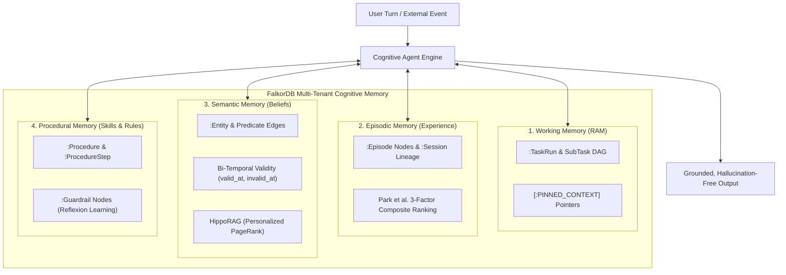

# AegisGraph Documentation Hub

Welcome to the comprehensive documentation suite for **AegisGraph**: the Multi-Tenant 4-Tier Cognitive Graph Memory & Autonomous Coordination Engine built on **FalkorDB**.

---

## Documentation Navigation

| Guide | Description | Target Audience |
| :--- | :--- | :--- |
| **[The 4 Memory Tiers](memory-tiers.md)** | Deep dive into **Episodic**, **Semantic**, **Working**, and **Procedural** memory schemas, graph topologies, properties, and node lifecycles. | Architects, Graph Engineers |
| **[Ingestion & Extraction](extraction.md)** | How unstructured turns are ingested, facts extracted via OpenIE structured outputs, bi-temporal edge conflicts resolved, and tool failures compiled into guardrails. | Backend Developers, AI Engineers |
| **[Dual-Path Retrieval](retrieval.md)** | Full mathematical and algorithmic analysis of **Park et al. 3-factor composite episodic recall** (Recency, Utility, Relevance) and **HippoRAG Personalized PageRank graph walks**. | Researchers, Algorithmic Engineers |
| **[Agent Integration Guide](agent-integration.md)** | Practical developer guide with runnable examples on integrating AegisGraph into custom agents via Python SDK, REST API, SSE streaming, and LangChain/LangGraph tools. | Agent Developers |
| **[API Reference](api-reference.md)** | Exhaustive endpoint specification for all FastAPI routes, request/response JSON schemas, and Server-Sent Events (SSE) payloads. | Frontend / API Consumers |

---

## Architectural Overview

---

## Recommended Reading Paths

### 1. For Agent & AI Application Developers
1. Start with **[Agent Integration Guide](agent-integration.md)** to run your first task with `multi_agent_engine`.
2. Review **[The 4 Memory Tiers](memory-tiers.md)** to understand how your agent's turns are organized into long-term graph memory.
3. Consult the **[API Reference](api-reference.md)** for HTTP and SSE streaming integration.

### 2. For Graph & Database Engineers
1. Read **[The 4 Memory Tiers](memory-tiers.md)** for exact OpenCypher labels, indexes, and relationship constraints.
2. Read **[Ingestion & Extraction](extraction.md)** to see how bi-temporal conflicts (`SINGLE` vs `MULTI` cardinality) are managed without data loss.
3. Study **[Dual-Path Retrieval](retrieval.md)** to understand native FalkorDB HNSW vector indexing and Personalized PageRank query execution.

### 3. For Researchers & Evaluators
1. Explore **[Dual-Path Retrieval](retrieval.md)** for the formal equations governing Ebbinghaus forgetting decay, MemRL reinforcement, vCache threshold gating, and HippoRAG spreading activation.
2. Read **[The 4 Memory Tiers](memory-tiers.md)** for CoALA, MemGPT, Zep, and Voyager research alignments.
3. Review the historical architectural plans preserved in `docs/*_PLAN.md`.
