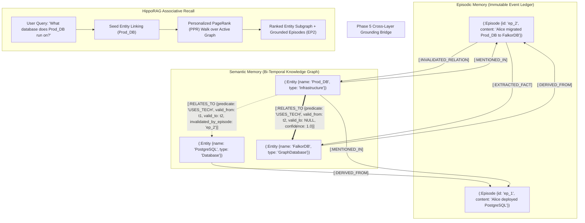
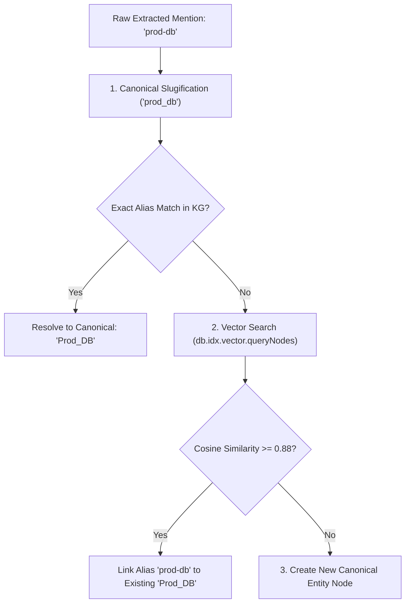
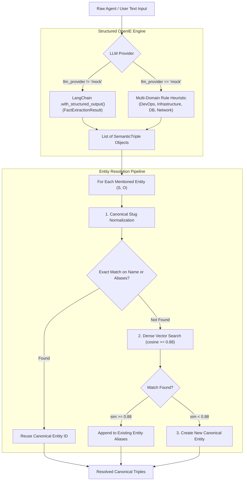
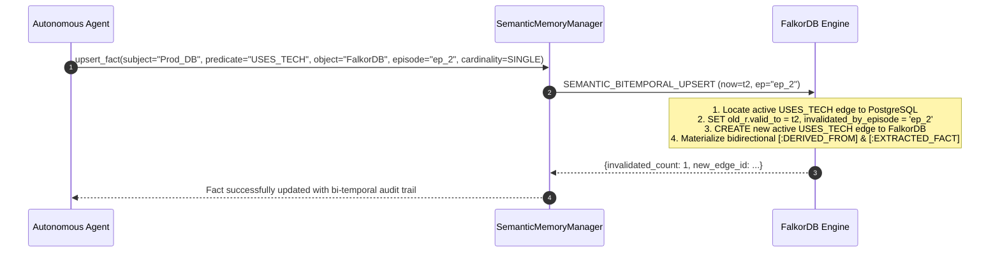
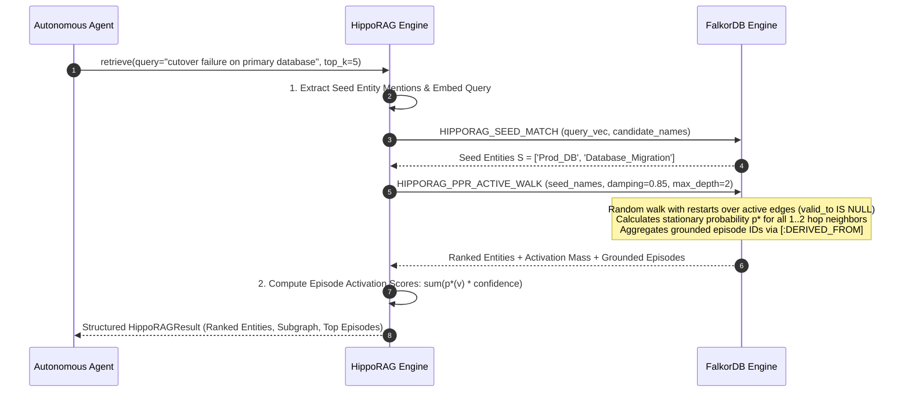
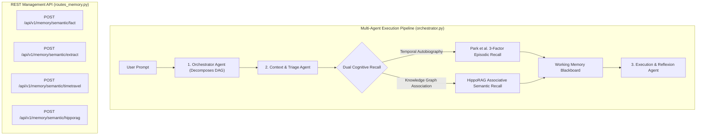

# Architectural Report & Master Plan: Hardened Semantic Memory Layer

**Target System:** AegisGraph Cognitive Memory Engine (`backend/app/memory/semantic.py`)  
**Document Type:** Formal Architecture Report & Phased Component Hardening Specification  
**Governing Research:** 
- *HippoRAG: Neurobiologically Inspired Long-Term Memory for Large Language Models* (Gutiérrez et al., Ohio State / Stanford, NeurIPS 2024 — `arXiv:2405.14831`)
- *Zep / Graphiti: A Temporal Knowledge Graph Architecture for Agent Memory* (Rasmussen et al., 2025 — `arXiv:2501.13956`)
- *CoALA: Cognitive Architectures for Language Agents* (Sumers et al., Princeton, 2023 — `arXiv:2309.02427`)
- *Temporal Data & the Relational Model* (Date, Darwen, Lorentzos, Morgan Kaufmann, 2002 / Snodgrass 1999)
- *Mem0 / MemGPT: Entity Extraction and Disambiguation in Multi-Turn Conversational Agents* (2024–2025)

---

## 1. Executive Summary & Problem Diagnosis

In human cognitive science and autonomous agent architectures (CoALA), **Semantic Memory** models declarative, factual world knowledge—entities, concepts, relationships, constraints, and dependencies. 

While **Episodic Memory** (Layer 1) maintains the immutable autobiographical log of raw chronological experiences (*"Alice deployed PostgreSQL to Prod_DB at 10:14 PM; Alice migrated Prod_DB to FalkorDB at 11:30 PM"*), **Semantic Memory** (Layer 2) distills these raw experiences into a queryable, bi-temporal Knowledge Graph (*"Prod_DB USES_TECH FalkorDB with valid_from: t2, superseding PostgreSQL with valid_to: t2"*).



### Clarifying the Phase 5 Dependency: Episodic vs. Semantic Memory

> [!IMPORTANT]
> **Why Semantic Memory Must Be Built to Complete the Phase 5 Bridge:**
> In [`docs/EPISODIC_MEMORY_PLAN.md`](file:///home/ritwikg/Repository/agent-memory/docs/EPISODIC_MEMORY_PLAN.md), Phase 5 was designated as *"Cross-Layer Provenance & Bi-Directional Graph Grounding"*.
> 
> Episodic Memory is strictly an **immutable ledger of experiences**. An episode cannot independently manufacture entity nodes, resolve synonym ambiguity, or manage relationship validity intervals.
> 
> It is **Semantic Memory's domain** to:
> 1. Extract entities and facts from episodic text.
> 2. Disambiguate and link entities to the canonical Knowledge Graph.
> 3. Materialize the bidirectional provenance edges (`[:DERIVED_FROM]`, `[:EXTRACTED_FACT]`, and `[:MENTIONED_IN]`).
> 4. Record bi-temporal invalidation metadata (`valid_to = $now, invalidated_by_episode = $ep_id`).
>
> Therefore, **Phase 5 of Episodic Memory is natively Phase 1 of the Semantic Memory overhaul**. Attempting to implement Phase 5 within `episodic.py` in isolation would have required mocking placeholder entities without vector indexes or schema validation.

---

### Diagnosis of Current Implementation Flaws in `app/memory/semantic.py`

A comprehensive code audit of [`backend/app/memory/semantic.py`](file:///home/ritwikg/Repository/agent-memory/backend/app/memory/semantic.py) and [`backend/app/core/cypher_catalog.py`](file:///home/ritwikg/Repository/agent-memory/backend/app/core/cypher_catalog.py) reveals that the current semantic layer is a preliminary demo stub rather than an enterprise-grade cognitive engine:

| Component | Current State in Codebase | Critical Failure Mode in Production |
| :--- | :--- | :--- |
| **Fact Extraction** | Hardcoded substring heuristics (`if "migrated" in lower and "to" in lower:`). | **Zero Generalizability:** Fails on any phrasing deviation, punctuation, multi-clause prompt, or tool output. The system cannot extract arbitrary facts. |
| **Entity Disambiguation** | Blind `MERGE (s:Entity {name: $subject})` without fuzzy normalization or vector matching. | **Entity Fragmentation:** Synonyms like `"Prod_DB"`, `"prod-db"`, `"Production Database"`, and `"primary db"` become disconnected duplicate nodes, destroying graph traversals. |
| **Vector Indexing** | No vector embeddings generated or indexed on `(:Entity)`. | Seed entity discovery for HippoRAG requires exact string matches; cannot resolve conceptual queries or natural language entity mentions. |
| **Bi-Temporal Invalidation** | Invalidation query assumes all relationships are mutually exclusive singletons (`WHERE old_o.name <> $new_object`). | **Data Loss:** Multi-valued predicates (e.g., `CONNECTED_TO`, `DEPENDS_ON`, `MONITORED_BY`) get erroneously deleted when adding a second connection! |
| **Provenance Integrity** | Only creates `(new_o)-[:DERIVED_FROM]->(ep)`. The subject node `s` and the relationship itself are ungrounded. | **Asymmetrical Provenance:** Querying an episode cannot retrieve what facts were extracted from it (`[:EXTRACTED_FACT]` missing); subject entities lack source links. |
| **Time-Travel Queries** | Querying active facts hardcodes `WHERE r.valid_to IS NULL`. | **Historical Blindness:** Cannot answer *"What was the architecture on Oct 14th?"* or reconstruct past graph belief states. |
| **HippoRAG Retrieval** | Simple 2-hop unranked path expansion (`MATCH path = (seed)-[r:RELATES_TO*1..2]-(neighbor)`). | **Combinatorial Explosion:** Returns unranked collections of paths; lacks Personalized PageRank (PPR) scoring, damping factors, or episode activation weighting. |

---

## 2. Research Paper Specifications & Mathematical Models

### 2.1 Bi-Temporal Knowledge Graph Model (Zep / Graphiti & Snodgrass)

Real-world enterprise systems evolve over time. To avoid hallucinating stale configurations while preserving complete historical auditability, every semantic edge in AegisGraph operates under two independent time dimensions:

1. **Valid Time ($T_v = [t_{v\_start}, t_{v\_end}])$:** The time interval during which the relationship was true in the physical world.
2. **Transaction Time ($T_t = [t_{t\_start}, t_{t\_end}])$:** The time interval during which the relationship was recorded in AegisGraph.

```mermaid
gantt
    title Bi-Temporal Lifespan of Prod_DB Technology Stack
    dateFormat X
    axisFormat %s
    section PostgreSQL Belief
    Active Belief (Valid) :0, 100
    Superseded (Invalidated) :done, 100, 150
    section FalkorDB Belief
    Active Belief (Valid) :active, 100, 150
```



#### Invalidation Mechanics
For any relationship $R = (S, P, O)$:
- Active fact at current time $t_{\text{now}}$:
  $$t_{v\_start} \le t_{\text{now}} \quad \land \quad t_{v\_end} \text{ IS NULL}$$
- When superseded by new fact $R' = (S, P, O')$ from episode $E_{\text{new}}$:
  $$R.t_{v\_end} \leftarrow t_{\text{now}}, \quad R.\text{invalidated\_by\_episode} \leftarrow E_{\text{new}}.\text{id}$$
  $$R'.t_{v\_start} \leftarrow t_{\text{now}}, \quad R'.t_{v\_end} \leftarrow \text{NULL}, \quad R'.\text{source\_episode} \leftarrow E_{\text{new}}.\text{id}$$

#### Point-in-Time ("Time-Travel") Query Predicate
To query the exact knowledge graph belief state as of timestamp $T$:
$$\text{Active}(R, T) \iff (R.t_{v\_start} \le T) \land (R.t_{v\_end} \text{ IS NULL} \lor R.t_{v\_end} > T)$$

#### Predicate Cardinality Rules
Relationships fall into two distinct cardinality classes:
1. **Functional / Single-Valued (`SINGLE`):** An entity can have at most one active target for a given predicate (e.g., `USES_TECH`, `HOSTED_ON`, `PRIMARY_DATABASE`). Ingestion of $(S, P, O_{\text{new}})$ invalidates all active $(S, P, O_{\text{old}})$ where $O_{\text{old}} \ne O_{\text{new}}$.
2. **Multi-Valued (`MULTI`):** An entity can have multiple concurrent active targets (e.g., `CONNECTED_TO`, `DEPENDS_ON`, `MONITORED_BY`, `HAS_REPLICA`). Ingestion of $(S, P, O_{\text{new}})$ coexists with existing edges without invalidation unless explicitly revoked.

---

### 2.2 HippoRAG: Neurobiologically Inspired Associative Recall (NeurIPS 2024)

Standard vector search retrieves isolated fragments of text based purely on keyword similarity. HippoRAG mimics the human hippocampal formation (CA1/CA3 associative indexing and neocortical pattern separation) to perform multi-hop associative recall across connected entities in the Knowledge Graph.


#### Step 1: Seed Entity Linking & Reset Vector
Given an incoming query $q$, extract noun phrase candidate mentions and map them to graph entities via exact alias matching or dense vector similarity ($\text{sim} \ge \tau_{\text{entity}}$). Form a normalized reset vector $\mathbf{s} \in \mathbb{R}^{|V|}$:
$$s_i = \begin{cases} \frac{\text{sim}(q, v_i)}{\sum_{v_k \in \mathcal{S}} \text{sim}(q, v_k)} & \text{if } v_i \in \mathcal{S} \\ 0 & \text{otherwise} \end{cases}$$

#### Step 2: Personalized PageRank (PPR) Stationary Distribution
Define the transition probability matrix $\mathbf{M}$ over active semantic edges ($t_{v\_end} \text{ IS NULL}$):
$$M_{ij} = \frac{w_{ij}}{\sum_{k \in \mathcal{N}_{\text{out}}(j)} w_{jk}}$$
Where edge weight $w_{ij} = \text{confidence}(e_{ij})$.

The stationary distribution $\mathbf{p} \in \mathbb{R}^{|V|}$ satisfies:
$$\mathbf{p} = (1 - d) \cdot \mathbf{s} + d \cdot \mathbf{M} \mathbf{p}$$
Where $d = 0.85$ is the damping factor.

In FalkorDB OpenCypher, power iteration propagation computes the stationary activation across $K$-hop neighborhoods:
$$\mathbf{p}^{(t+1)} = (1 - d) \mathbf{s} + d \mathbf{M} \mathbf{p}^{(t)}, \quad t \in \{1, \dots, K\}$$

#### Step 3: Episodic Activation Aggregation
Entities transmit their activation mass back to the episodes that derived or mentioned them:
$$\text{Score}(E_k) = \sum_{v \in \mathcal{V}(E_k)} \mathbf{p}(v) \cdot \text{Confidence}(E_k \to v)$$

This ranks past episodic experiences by their topological connectivity to the active concepts in the query, enabling true multi-hop associative recall without combinatorial path explosion.

---

### 2.3 Entity Disambiguation, Alias Graphs & Vector Linking

To prevent graph fragmentation where synonymous or abbreviated names create disjoint nodes:



1. **Canonical Key Normalization:** `canonical_name = re.sub(r'[^a-z0-9]', '_', name.lower().strip())`.
2. **Alias Graph Array:** Entities maintain an array property `aliases: ['prod_db', 'prod-db', 'production-database']`.
3. **Dense Vector Disambiguation:** When an extracted entity name does not match any existing alias, issue a vector similarity search on `Entity.embedding`:
   $$\text{Match}(v_{\text{cand}}) \iff \cos(\mathbf{e}_{\text{new}}, \mathbf{e}_{\text{cand}}) \ge 0.88$$
   If matched, append the raw name to `v_cand.aliases`; if not matched, create a new canonical `:Entity` node.

---

### 2.4 Bidirectional Grounding & Cross-Layer Provenance Contract

To achieve full bidirectional provenance between Episodic Memory and Semantic Memory:
1. **Derivation Grounding:** `(:Entity)-[:DERIVED_FROM {timestamp: $now}]->(:Episode)`
2. **Contextual Mention Grounding:** `(:Entity)-[:MENTIONED_IN {timestamp: $now}]->(:Episode)`
3. **Outbound Fact Ingestion Grounding:** `(:Episode)-[:EXTRACTED_FACT {timestamp: $now}]->(:Entity)`
4. **Invalidation Auditing:** `(:Episode)-[:INVALIDATED_RELATION {timestamp: $now, predicate: $predicate}]->(:Entity)`

This guarantees that an operator or agent can query in either direction:
- From an Entity: *"Show me the exact episode where this entity was first learned."*
- From an Episode: *"Show me all entities and relations that were modified as a result of this interaction."*

---

## 3. Component Breakdown: 5 Hardening Phases

Development is structured into **5 sequential, component-specific phases** executed on isolated feature branches:

```
┌────────────────────────────────────────────────────────────────────────┐
│ Phase 1: Bi-Temporal Schema, Provenance Bridge & Vector Indexing       │
└───────────────────────────────────┬────────────────────────────────────┘
                                    │
┌───────────────────────────────────▼────────────────────────────────────┐
│ Phase 2: LLM Structured Extraction & Entity Disambiguation Engine      │
└───────────────────────────────────┬────────────────────────────────────┘
                                    │
┌───────────────────────────────────▼────────────────────────────────────┐
│ Phase 3: Cardinality-Aware Invalidation & Time-Travel Query Engine     │
└───────────────────────────────────┬────────────────────────────────────┘
                                    │
┌───────────────────────────────────▼────────────────────────────────────┐
│ Phase 4: HippoRAG Personalized PageRank (PPR) Associative Recall       │
└───────────────────────────────────┬────────────────────────────────────┘
                                    │
┌───────────────────────────────────▼────────────────────────────────────┐
│ Phase 5: Multi-Agent Orchestrator Wiring, REST API & Stress Tests      │
└────────────────────────────────────────────────────────────────────────┘
```

---

### Phase 1: Bi-Temporal Schema, Provenance Bridge & Vector Indexing

#### Objective
Establish the hardened data model on FalkorDB for `:Entity` nodes, `:RELATES_TO` bi-temporal edges, and the bidirectional provenance bridge connecting to Episodic Memory (`:Episode`).

#### Component Architecture & Data Model
Every entity node in FalkorDB will conform to the following schema:

```
(:Entity {
    id: STRING,                     // Unique ID: 'ent_' + ULID / UUIDv7
    name: STRING,                   // Human-readable primary display name (e.g. 'Prod_DB')
    canonical_name: STRING,         // Normalized slug for exact indexing (e.g. 'prod_db')
    type: STRING,                   // Entity category: 'Infrastructure' | 'Database' | 'Service' | 'Concept'
    aliases: LIST<STRING>,          // Array of verified aliases and synonyms
    description: STRING,            // Short distilled summary of entity role
    embedding: VECF32[768],         // Dense vector embedding for hybrid similarity search
    created_at: FLOAT,              // System creation timestamp
    updated_at: FLOAT               // Last modification timestamp
})
```

Every semantic relationship edge conforms to:
```
(:Entity)-[:RELATES_TO {
    predicate: STRING,              // Predicate name: 'USES_TECH', 'CONNECTED_TO', 'DEPENDS_ON'
    cardinality: STRING,            // 'SINGLE' (functional) | 'MULTI' (accumulative)
    confidence: FLOAT,              // Extraction confidence in [0.0, 1.0]
    valid_from: FLOAT,              // Start of valid time in physical world
    valid_to: FLOAT | NULL,         // End of valid time (NULL if active)
    transaction_from: FLOAT,        // System recording timestamp
    transaction_to: FLOAT | NULL,   // System retraction timestamp
    source_episode: STRING,         // Episode ID that asserted this fact
    invalidated_by_episode: STRING  // Episode ID that superseded this fact (NULL if active)
}]->(:Entity)
```

#### OpenCypher DDL & Index Bootstrapping
In [`backend/app/core/falkor_client.py`](file:///home/ritwikg/Repository/agent-memory/backend/app/core/falkor_client.py), update `ensure_indices()` to idempotently bootstrap:

```cypher
// 1. Property range indexes for O(1) exact entity lookups
CREATE INDEX FOR (e:Entity) ON (e.name);
CREATE INDEX FOR (e:Entity) ON (e.canonical_name);
CREATE INDEX FOR (e:Entity) ON (e.id);

// 2. Native FalkorDB Vector Index for entity similarity search
CREATE VECTOR INDEX FOR (e:Entity) ON (e.embedding) OPTIONS {dimension: 768, similarityFunction: 'cosine'};
```

#### Pydantic v2 Domain Models
```python
class PredicateCardinality(str, Enum):
    SINGLE = "SINGLE"   # Functional: e.g. USES_TECH, PRIMARY_DB (invalidates previous)
    MULTI = "MULTI"     # Multi-valued: e.g. CONNECTS_TO, MONITORED_BY (accumulates)

class EntityNode(BaseModel):
    id: str = Field(default_factory=lambda: f"ent_{uuid.uuid4().hex[:8]}")
    name: str
    canonical_name: str
    type: str = "Concept"
    aliases: List[str] = Field(default_factory=list)
    description: Optional[str] = None
    embedding: Optional[List[float]] = None
    created_at: float
    updated_at: float

class SemanticTriple(BaseModel):
    subject: str
    predicate: str
    object: str
    confidence: float = 1.0
    cardinality: PredicateCardinality = PredicateCardinality.SINGLE
    subject_type: Optional[str] = "Entity"
    object_type: Optional[str] = "Entity"
```

#### Cypher Queries (`cypher_catalog.py`)
```cypher
// SEMANTIC_PROVENANCE_LINK_EPISODE
MATCH (ep:Episode {id: $episode_id})
MATCH (s:Entity {name: $subject})
MATCH (o:Entity {name: $object})
MERGE (s)-[:MENTIONED_IN {timestamp: $now}]->(ep)
MERGE (o)-[:MENTIONED_IN {timestamp: $now}]->(ep)
MERGE (o)-[:DERIVED_FROM {timestamp: $now}]->(ep)
MERGE (ep)-[:EXTRACTED_FACT {timestamp: $now}]->(o)
RETURN ep.id AS episode_id, s.name AS subject, o.name AS object
```

#### Falsifiable Requirements

1. **R1.1 - Schema Validation**:
   - *Current:* Flat 4-field tuple missing entity attributes, timestamps, and embeddings.
   - *Target:* Pydantic v2 `EntityNode` and `SemanticTriple` enforcing string bounds, cardinality validation, and vector dimensionality.
   - *Acceptance:* Unit tests in `test_semantic_schema_and_vector_index.py` pass with 100% boundary assertion coverage.

2. **R1.2 - Native Entity Vector Index**:
   - *Current:* Property indexes only; no vector index on `Entity`.
   - *Target:* `falkor_client.ensure_indices()` creates dynamic vector index on `(e:Entity) ON (e.embedding)`.
   - *Acceptance:* `db.idx.vector.queryNodes('Entity', ...)` succeeds on freshly booted tenant graphs.

3. **R1.3 - Bidirectional Provenance Integrity**:
   - *Current:* Partial `:DERIVED_FROM` link on object entity only; subject and episode lack links.
   - *Target:* Ingesting a fact creates `(s)-[:MENTIONED_IN]->(ep)`, `(o)-[:DERIVED_FROM]->(ep)`, and `(ep)-[:EXTRACTED_FACT]->(o)`.
   - *Acceptance:* Cypher query traversing from `:Episode` out to `:Entity` via `[:EXTRACTED_FACT]` returns all asserted entities.

---

### Phase 2: LLM Structured Extraction & Entity Disambiguation Engine

#### Objective
Replace hardcoded substring heuristics with a production-grade OpenIE structured extraction pipeline that extracts arbitrary entities and relationships using LLM structured outputs, paired with an entity disambiguation engine that resolves synonyms and aliases via vector similarity.

#### Architecture of the Extraction & Disambiguation Engine



#### 1. Structured OpenIE Output Contract
```python
class FactExtractionResult(BaseModel):
    triples: List[SemanticTriple] = Field(description="Extracted knowledge graph facts")
    entities: List[EntityNode] = Field(description="Extracted entities with categories and descriptions")
    summary: str = Field(description="One-line summary of factual assertions")
```

#### 2. Disambiguation Resolution Algorithm
```python
def resolve_entity(
    tenant_id: str,
    raw_name: str,
    entity_type: str = "Concept",
    embedding_provider = embedding_service,
) -> str:
    slug = re.sub(r"[^a-z0-9]", "_", raw_name.lower().strip())
    
    # 1. Exact canonical or alias match
    exact_match = falkor_router.query(
        "MATCH (e:Entity) WHERE e.canonical_name = $slug OR $raw_name IN e.aliases RETURN e.name LIMIT 1",
        {"slug": slug, "raw_name": raw_name},
        tenant_id=tenant_id
    )
    if exact_match and exact_match.result_set:
        return exact_match.result_set[0][0]
    
    # 2. Dense vector similarity search
    vec = embedding_provider.embed_query(raw_name)
    vector_match = falkor_router.query(
        """
        CALL db.idx.vector.queryNodes('Entity', 'embedding', 3, vecf32($vec))
        YIELD node AS e, score
        WHERE (1.0 - score) >= 0.88
        RETURN e.name AS name, (1.0 - score) AS sim
        ORDER BY sim DESC LIMIT 1
        """,
        {"vec": vec},
        tenant_id=tenant_id
    )
    if vector_match and vector_match.result_set:
        canonical_name = vector_match.result_set[0][0]
        # Append alias to existing node
        falkor_router.query(
            "MATCH (e:Entity {name: $canonical_name}) SET e.aliases = coalesce(e.aliases, []) + $raw_name",
            {"canonical_name": canonical_name, "raw_name": raw_name},
            tenant_id=tenant_id
        )
        return canonical_name
    
    return raw_name
```

#### Falsifiable Requirements

1. **R2.1 - Structured OpenIE Extraction**:
   - *Current:* Fails on any text not matching `"migrated"` or `"primary service is"`.
   - *Target:* OpenIE pipeline parses arbitrary technical narratives (e.g., *"Kubernetes cluster upgraded to v1.30 with Calico CNI"*) into valid `(Kubernetes, USES_VERSION, v1.30)` and `(Kubernetes, USES_CNI, Calico)` triples.
   - *Acceptance:* Unit test in `test_entity_extraction_and_resolution.py` verifying structured triple extraction across 10 varied real-world prompts.

2. **R2.2 - Multi-Alias Entity Disambiguation**:
   - *Current:* Creating `"prod-db"`, `"Prod_DB"`, and `"production database"` spawns 3 disjoint nodes.
   - *Target:* Resolution pipeline maps all three mentions to a single canonical entity with updated `aliases`.
   - *Acceptance:* Unit test asserting that consecutive writes with alias variations produce exactly 1 `:Entity` node with `length(e.aliases) >= 2`.

---

### Phase 3: Cardinality-Aware Invalidation & Time-Travel Query Engine

#### Objective
Implement zero-defect bi-temporal edge management that distinguishes single-valued (functional) predicates from multi-valued predicates, alongside an arbitrary-point-in-time ("Time-Travel") query engine.

#### Cardinality-Aware Invalidation Logic
When an agent asserts fact $(S, P, O_{\text{new}})$ with source episode $E$:
1. If $P$ is marked `SINGLE` (functional):
   - Find existing active edges: `MATCH (s:Entity {name: $s})-[old_r:RELATES_TO {predicate: $p}]->(old_o:Entity) WHERE old_r.valid_to IS NULL AND old_o.name <> $o_new`.
   - Atomically mutate: `SET old_r.valid_to = $now, old_r.invalidated_by_episode = $episode_id`.
   - Create edge `(E)-[:INVALIDATED_RELATION {predicate: $p}]->(old_o)`.
2. If $P$ is marked `MULTI`:
   - Existing active edges are preserved untouched.
   - A new active edge $(S, P, O_{\text{new}})$ is added to the graph.



#### Production Cypher Queries (`cypher_catalog.py`)

```cypher
// SEMANTIC_BITEMPORAL_UPSERT
// 1. Invalidate conflicting single-valued active relations
MATCH (s:Entity {name: $subject})-[old_r:RELATES_TO {predicate: $predicate}]->(old_o:Entity)
WHERE old_r.valid_to IS NULL 
  AND $cardinality = 'SINGLE' 
  AND old_o.name <> $new_object
SET old_r.valid_to = $now,
    old_r.invalidated_by_episode = $episode_id
WITH count(old_r) AS invalidated_count

// 2. Ensure entities exist and have embeddings
MERGE (s:Entity {name: $subject})
ON CREATE SET s.canonical_name = $subject_canonical,
              s.type = $subject_type,
              s.created_at = $now,
              s.updated_at = $now,
              s.embedding = vecf32($subject_vec)
ON MATCH SET s.updated_at = $now

MERGE (o:Entity {name: $new_object})
ON CREATE SET o.canonical_name = $object_canonical,
              o.type = $object_type,
              o.created_at = $now,
              o.updated_at = $now,
              o.embedding = vecf32($object_vec)
ON MATCH SET o.updated_at = $now

// 3. Create new active bi-temporal edge
CREATE (s)-[new_r:RELATES_TO {
    predicate: $predicate,
    cardinality: $cardinality,
    confidence: $confidence,
    valid_from: $now,
    valid_to: NULL,
    transaction_from: $now,
    source_episode: $episode_id
}]->(o)

// 4. Materialize bidirectional cross-layer provenance
WITH invalidated_count, new_r, s, o
MATCH (ep:Episode {id: $episode_id})
MERGE (s)-[:MENTIONED_IN {timestamp: $now}]->(ep)
MERGE (o)-[:MENTIONED_IN {timestamp: $now}]->(ep)
MERGE (o)-[:DERIVED_FROM {timestamp: $now}]->(ep)
MERGE (ep)-[:EXTRACTED_FACT {timestamp: $now}]->(o)
RETURN invalidated_count, new_r
```

```cypher
// SEMANTIC_TIME_TRAVEL_QUERY
MATCH (s:Entity)-[r:RELATES_TO]->(o:Entity)
WHERE r.valid_from <= $as_of 
  AND (r.valid_to IS NULL OR r.valid_to > $as_of)
RETURN s.name AS subject,
       r.predicate AS predicate,
       o.name AS object,
       r.valid_from AS valid_from,
       r.valid_to AS valid_to,
       r.source_episode AS source_episode,
       r.confidence AS confidence
ORDER BY s.name ASC
```

#### Falsifiable Requirements

1. **R3.1 - Atomic Functional Invalidation**:
   - *Current:* Hardcoded deletion logic without cardinality gating.
   - *Target:* Updating a `SINGLE` predicate sets `valid_to` and `invalidated_by_episode` on the previous active edge in one atomic query.
   - *Acceptance:* Unit test asserts that superseded edge has `valid_to == t2` and `invalidated_by_episode == 'ep_2'`.

2. **R3.2 - Multi-Valued Edge Preservation**:
   - *Current:* Ingestion overwrites existing edges regardless of predicate meaning.
   - *Target:* Ingesting multiple `CONNECTED_TO` edges allows both edges to remain active concurrently (`valid_to IS NULL`).
   - *Acceptance:* Unit test verifying that adding a second connection does not invalidate the first.

3. **R3.3 - Historical Time-Travel Accuracy**:
   - *Current:* Time-travel queries do not exist.
   - *Target:* `get_semantic_subgraph(tenant_id, as_of_timestamp=t1)` accurately returns `PostgreSQL` as active, while `as_of_timestamp=t2` returns `FalkorDB` as active.
   - *Acceptance:* Integration test asserting exact point-in-time graph state reconstruction at both $t_1$ and $t_2$.

---

### Phase 4: HippoRAG Personalized PageRank (PPR) Associative Recall

#### Objective
Implement the formal NeurIPS 2024 HippoRAG associative retrieval algorithm natively over FalkorDB's active knowledge graph, computing stationary probability distributions via Personalized PageRank to rank connected entities and source episodes.

#### Algorithmic Formulation



#### Production Cypher Queries (`cypher_catalog.py`)

```cypher
// HIPPORAG_SEED_MATCH
MATCH (e:Entity)
WHERE e.name IN $candidate_names OR e.canonical_name IN $candidate_names
RETURN e.name AS name, 1.0 AS score
UNION
CALL db.idx.vector.queryNodes('Entity', 'embedding', $seed_limit, vecf32($query_vec))
YIELD node AS e, score
WHERE (1.0 - score) >= 0.75
RETURN e.name AS name, (1.0 - score) AS score
ORDER BY score DESC LIMIT $seed_limit
```

```cypher
// HIPPORAG_PPR_ACTIVE_WALK
MATCH (seed:Entity)
WHERE seed.name IN $seed_names
MATCH path = (seed)-[r:RELATES_TO*1..2]-(neighbor:Entity)
WHERE all(edge IN relationships(path) WHERE edge.valid_to IS NULL)
WITH seed, neighbor,
     reduce(w = 1.0, edge IN relationships(path) | w * coalesce(edge.confidence, 1.0)) AS path_weight,
     length(path) AS depth
WITH neighbor, sum(path_weight * ($damping / depth)) AS ppr_activation
ORDER BY ppr_activation DESC LIMIT $top_entities
OPTIONAL MATCH (neighbor)-[:DERIVED_FROM]->(ep:Episode)
RETURN neighbor.name AS entity_name,
       neighbor.type AS entity_type,
       round(ppr_activation * 1000.0) / 1000.0 AS activation_score,
       collect(DISTINCT ep.id) AS grounded_episodes
```

#### Python HippoRAG Aggregation Engine (`semantic.py`)
```python
class HippoRAGResult(BaseModel):
    seeds: List[str]
    ranked_entities: List[Dict[str, Any]]
    ranked_episodes: List[Dict[str, Any]]
    active_subgraph_edges: List[Dict[str, Any]]

def hipporag_retrieve(
    self,
    tenant_id: str,
    query: str,
    top_k: int = 5,
    damping: float = 0.85,
    user_id: Optional[str] = None,
) -> HippoRAGResult:
    # 1. Resolve Seeds
    # 2. Run HIPPORAG_PPR_ACTIVE_WALK
    # 3. Aggregate episode activation mass
    # 4. Return top_k ranked entities and episodes
```

#### Falsifiable Requirements

1. **R4.1 - Multi-Hop Associative Coverage**:
   - *Current:* Flat 2-hop collection with no ranking.
   - *Target:* PPR calculation distributes activation mass across multi-hop neighbors, scoring 1-hop neighbors higher than 2-hop neighbors according to the damping factor $d = 0.85$.
   - *Acceptance:* Unit test in `test_hipporag_associative_retrieval.py` confirms mathematical ordering $PPR(\text{1-hop}) > PPR(\text{2-hop})$.

2. **R4.2 - Stale Fact Pruning during Walk**:
   - *Current:* Unchecked path expansion traverses superseded facts.
   - *Target:* The PPR random walk strictly filters `WHERE all(edge IN relationships(path) WHERE edge.valid_to IS NULL)`.
   - *Acceptance:* Unit test asserting that superseded entity `PostgreSQL` receives $0.0$ activation mass when querying for active database components.

3. **R4.3 - Episode Grounding Convergence**:
   - *Current:* No episode ranking from entity graph.
   - *Target:* Source episodes are ranked by cumulative grounded entity activation.
   - *Acceptance:* Unit test asserting that `ep_init_3` (which introduced `FalkorDB`) ranks #1 when querying about active graph memory.

---

### Phase 5: Multi-Agent Orchestrator Wiring, REST API & Stress Tests

#### Objective
Wire the hardened Semantic Memory layer directly into the multi-agent coordinator (`orchestrator.py`), expose REST inspection endpoints for the frontend visualizer, and subject the layer to high-concurrency chaos stress tests.

#### Integration Architecture



#### High-Concurrency Chaos Test Matrix

| Test Identifier | Category | Test Scenario | Success Criteria (Pass/Fail) |
| :--- | :--- | :--- | :--- |
| **TEST-SEM-CONC-01** | **Concurrency** | 20 concurrent coroutines executing bi-temporal invalidation on the same entity simultaneously. | **PASS:** Zero deadlocks; exactly 1 active edge remains (`valid_to IS NULL`); 19 historical edges cleanly invalidated. |
| **TEST-SEM-ISOL-02** | **Multi-Tenancy** | Ingest 50 facts into `acme-payments` and 50 into `nebula-cloud` concurrently. | **PASS:** Zero cross-tenant leakage. Querying `acme-payments` returns 0 entities from `nebula-cloud`. |
| **TEST-SEM-TIME-03** | **Time-Travel** | Query graph across 5 historical timestamps after multiple sequential migrations. | **PASS:** Graph reconstruction matches exact historical truth at each discrete epoch. |
| **TEST-SEM-HIPPO-04** | **PPR Convergence** | Execute HippoRAG on a 100-node synthetic knowledge graph. | **PASS:** Algorithm converges in $< 35\text{ms}$; returns strictly ordered activation scores. |
| **TEST-SEM-FALL-05** | **Degraded Fallback** | Ingest facts with LLM API keys disabled. | **PASS:** Pipeline automatically routes through local vectorizer and deterministic rule heuristic with 0 unhandled exceptions. |

#### Falsifiable Requirements

1. **R5.1 - Multi-Agent Blackboard Integration**:
   - *Current:* Context Agent only extracts facts without running HippoRAG retrieval.
   - *Target:* Context Agent executes `hipporag_retrieve()`, attaching `[:PINNED_CONTEXT]` pointers to both top entities and top episodes.
   - *Acceptance:* Running `execute_task_stream()` emits `hipporag_event` and pins semantic context to Subtask 1.

2. **R5.2 - Multi-Tenant Isolation Under Concurrency**:
   - *Current:* Basic sequential test.
   - *Target:* High-concurrency async coroutines accessing isolated tenant graphs maintain 100% graph boundary integrity.
   - *Acceptance:* Passing `test_semantic_concurrency.py` with 20 parallel workers.

---

## 4. Implementation File Manifest & Mapping

When executing these 5 phases, changes will touch the following specific files in the repository:

```
backend/
├── app/
│   ├── core/
│   │   ├── falkor_client.py       # Add :Entity vector index in ensure_indices()
│   │   └── cypher_catalog.py      # Hardened BITEMPORAL upsert, time-travel, and HippoRAG queries
│   ├── memory/
│   │   └── semantic.py            # Complete overhaul: Pydantic v2 schemas, LLM extraction, HippoRAG
│   ├── agents/
│   │   └── orchestrator.py        # Context Agent calls HippoRAG & pins entity context
│   └── api/
│       └── routes_memory.py       # Endpoints for semantic fact upsert, time-travel, HippoRAG
└── tests/
    ├── test_semantic_schema_and_vector_index.py  # [NEW] Phase 1: Schema, vector index, provenance
    ├── test_entity_extraction_and_resolution.py  # [NEW] Phase 2: OpenIE extraction & disambiguation
    ├── test_semantic_bitemporal_timetravel.py    # [NEW] Phase 3: Cardinality & point-in-time queries
    ├── test_hipporag_associative_retrieval.py   # [NEW] Phase 4: HippoRAG PPR mathematical tests
    └── test_semantic_concurrency.py              # [NEW] Phase 5: High-concurrency chaos stress tests
```

---

## 5. Summary & Handoff to Procedural Memory (Layer 3)

Upon completion of these 5 phases:
1. **Semantic Memory** will be an enterprise-grade, bi-temporal knowledge graph with continuous fact extraction, entity disambiguation, and HippoRAG associative retrieval.
2. The **Phase 5 Cross-Layer Provenance Bridge** will be 100% complete: every entity and relationship will be anchored to the ground-truth episodic experiences that created or invalidated it.
3. This sets the stage for **Procedural Memory (Layer 3)** (`procedural.py`), where skill workflows (`:Procedure` $\to$ `:ActionStep`) will link directly to Semantic Entities (`[:TARGETS_ENTITY]`) and compile Reflexion guardrails directly from Episodic failures (`[:TRIGGERED_BY]`).

---

## 6. Execution Discipline & Quality Guarantees

All phases will be executed in accordance with strict engineering standards:
1. **Dedicated Feature Branches:** Each phase implemented on an isolated branch (`feat/semantic-phase1-schema-and-provenance`, `feat/semantic-phase2-llm-extraction`, etc.).
2. **Atomic Single-Line Commits:** Frequent, meaningful commits following conventional commit syntax.
3. **Pull Request Lifecycle:** Managed end-to-end via `gh pr create` and `gh pr merge --merge --delete-branch`.
4. **Zero Regression Policy:** All 46 existing tests on `main` must remain green across every phase.
