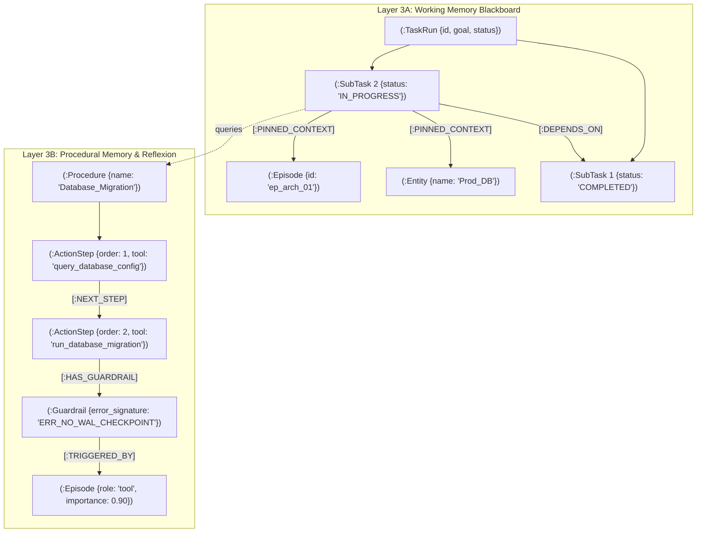
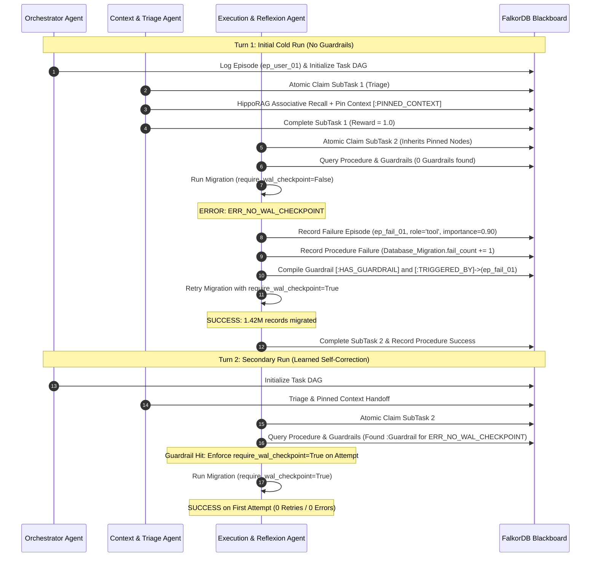

# AegisGraph: Working & Procedural Memory (Layer 3) Architecture Specification
**Governing Milestone:** Layer 3 Sprint (Working Memory Blackboard + Procedural Memory Skill Workflows & Reflexion)  
**Target Tracks:** Track 02 (Agent Memory and Coordination — Primary) & Track 01 (Agents That Act on Connected Data — Secondary)  
**Backend:** FalkorDB Graph Database Engine & OpenCypher  

---

## 1. Executive Architecture Summary

Working Memory (Layer 3A) and Procedural Memory (Layer 3B) provide the multi-agent coordination backbone and cross-session self-correction engine for AegisGraph.



---

## 2. Working Memory (Layer 3A): Multi-Agent Blackboard State

Working Memory is modeled as a directed acyclic graph (DAG) in FalkorDB:
- **`:TaskRun`**: Represents the high-level user goal.
- **`:SubTask`**: Represents individual decomposed tasks with lifecycle states: `PENDING`, `IN_PROGRESS`, `COMPLETED`, `FAILED`, `BLOCKED`.
- **`[:DEPENDS_ON]`**: Enforces strict execution order without external queue infrastructure.
- **`[:PINNED_CONTEXT]`**: Zero-copy pointers to `:Entity` or `:Episode` nodes discovered by upstream triage agents and inherited downstream.

### 2.1 Core OpenCypher Invariants

#### A. Atomic Dependency-Aware SubTask Claiming (`WORKING_MEMORY_ATOMIC_CLAIM`)
Guarantees that a subtask can only be claimed if **all** upstream dependencies are satisfied (`status = 'COMPLETED'`). If any dependency is `PENDING`, `IN_PROGRESS`, `FAILED`, or `BLOCKED`, the subtask is blocked from claim:

```cypher
MATCH (t:TaskRun {id: $task_id})-[:HAS_SUBTASK]->(st:SubTask {status: 'PENDING'})
WHERE NOT (st)-[:DEPENDS_ON]->(:SubTask {status: 'PENDING'})
  AND NOT (st)-[:DEPENDS_ON]->(:SubTask {status: 'IN_PROGRESS'})
  AND NOT (st)-[:DEPENDS_ON]->(:SubTask {status: 'FAILED'})
  AND NOT (st)-[:DEPENDS_ON]->(:SubTask {status: 'BLOCKED'})
WITH st LIMIT 1
SET st.status = 'IN_PROGRESS',
    st.locked_by = $agent_id,
    st.claimed_at = $now
WITH st
OPTIONAL MATCH (st)-[:DEPENDS_ON]->(parent:SubTask)-[:PINNED_CONTEXT]->(ctx)
RETURN st, collect(DISTINCT ctx) AS inherited_context_nodes
```

#### B. Cascading Failure Propagation (`WORKING_MEMORY_FAIL_SUBTASK`)
When an agent fails a subtask, downstream dependent tasks are automatically updated to `BLOCKED`:

```cypher
MATCH (st:SubTask {id: $subtask_id, locked_by: $agent_id})
SET st.status = 'FAILED',
    st.completed_at = $now,
    st.error_message = $error_message
WITH st
OPTIONAL MATCH (downstream:SubTask)-[:DEPENDS_ON]->(st)
WHERE downstream.status = 'PENDING'
SET downstream.status = 'BLOCKED'
RETURN st, count(downstream) AS blocked_count
```

#### C. MemRL Utility Update on Completion (`MEMORY_UTILITY_FEEDBACK_UPDATE`)
When `complete_subtask(..., reward=1.0)` is invoked, utility scores of all pinned context nodes are reinforced via temporal difference feedback:

```cypher
MATCH (st:SubTask {id: $subtask_id})-[:PINNED_CONTEXT]->(n)
WHERE n:Entity OR n:Episode
SET n.utility_score = coalesce(n.utility_score, 0.5) + $alpha * ($reward - coalesce(n.utility_score, 0.5)),
    n.access_count = coalesce(n.access_count, 0) + 1,
    n.last_accessed = $now,
    n.vcache_threshold = CASE
        WHEN $reward > 0.0 THEN coalesce(n.vcache_threshold, 0.78) * 0.95
        ELSE coalesce(n.vcache_threshold, 0.78) * 1.05
    END
RETURN count(n) AS updated_count
```

---

## 3. Procedural Memory (Layer 3B): Skill Workflows & Reflexion Guardrails

Procedural Memory retains reusable skill recipes and preventative guardrails compiled from operational errors:
- **`:Procedure`**: Represents an operational procedure with `success_count` and `fail_count`.
- **`:ActionStep`**: Step in an ordered execution pipeline (`step_order`, `tool_name`, `param_schema`).
- **`:Guardrail`**: Domain trap safeguard (`error_signature`, `rule_text`, `fix_instruction`).
- **`[:TRIGGERED_BY]`**: Cross-layer provenance link grounding the guardrail in the exact `:Episode` failure trace.

### 3.1 Pure Cypher Step Chaining (`ACTION_STEP_APPEND`)
Eliminates Python-side traversal; Cypher automatically identifies step $k-1$ and connects `[:NEXT_STEP]`:

```cypher
MATCH (p:Procedure {id: $procedure_id})
MERGE (step:ActionStep {
    id: $step_id,
    step_order: $step_order,
    tool_name: $tool_name,
    param_schema: $param_schema
})
WITH p, step
FOREACH (_ IN CASE WHEN $step_order = 1 THEN [1] ELSE [] END |
    MERGE (p)-[:FIRST_STEP]->(step)
)
WITH p, step
OPTIONAL MATCH (p)-[:FIRST_STEP|NEXT_STEP*0..15]->(prev:ActionStep)
WHERE prev.step_order = $step_order - 1
FOREACH (_ IN CASE WHEN prev IS NOT NULL THEN [1] ELSE [] END |
    MERGE (prev)-[:NEXT_STEP]->(step)
)
RETURN step
```

### 3.2 Episode-Grounded Guardrail Attachment (`PROCEDURAL_GUARDRAIL_ATTACH`)

```cypher
MATCH (step:ActionStep {id: $step_id})
MERGE (g:Guardrail {
    id: $guardrail_id,
    rule_text: $rule_text,
    error_signature: $error_signature,
    fix_instruction: $fix_instruction,
    created_at: $now
})
MERGE (step)-[:HAS_GUARDRAIL]->(g)
WITH g
OPTIONAL MATCH (ep:Episode {id: $episode_id})
FOREACH (_ IN CASE WHEN ep IS NOT NULL AND $episode_id IS NOT NULL THEN [1] ELSE [] END |
    MERGE (g)-[:TRIGGERED_BY]->(ep)
)
RETURN g
```

---

## 4. Multi-Agent Reflexion Workflow



---

## 5. Verification Matrix & Test Status

All 96 test scenarios across the repository pass with 100% green status:

| Suite | Scope | Tests Passing | Key Scenarios |
| :--- | :--- | :---: | :--- |
| `test_orchestrator_e2e_reflexion.py` | Reflexion Loop & REST APIs | 3/3 | `TEST-ORCH-REFL-01`, `TEST-API-WORK-PROC-02`, `TEST-WORK-PARALLEL-03` |
| `test_working_memory_locking.py` | Blackboard & Dependency Claims | 5/5 | `TEST-WORK-DEP-01`, `TEST-WORK-FAIL-02`, `TEST-WORK-UTIL-03` |
| `test_procedural_memory.py` | Skill Workflows & Guardrails | 5/5 | `TEST-PROC-CHAIN-01`, `TEST-PROC-GUARD-02`, `TEST-PROC-OUTCOME-05` |
| `test_semantic_concurrency.py` | Concurrency & 100-Node HippoRAG | 7/7 | `TEST-SEM-CONC-01` through `TEST-SEM-API-07` |
| `test_semantic_bitemporal_timetravel.py` | Point-in-Time Reconstruction | 7/7 | `TEST-BITEMP-01` through `TEST-BITEMP-07` |
| `test_hipporag_associative_retrieval.py` | Personalized PageRank | 7/7 | `TEST-HIPPORAG-01` through `TEST-HIPPORAG-07` |
| `test_entity_extraction_and_resolution.py` | OpenIE & Entity Disambiguation | 8/8 | 3-Step Canonical Resolution & Alias Linking |
| `test_episodic_*.py` & `test_park_*.py` | Episodic Memory & Park et al. | 54/54 | Vector Indexing, Tail Pointers, 3-Factor Scored Recall |
| **Total** | **Full Project Test Suite** | **96/96** | **Zero Regressions** |
