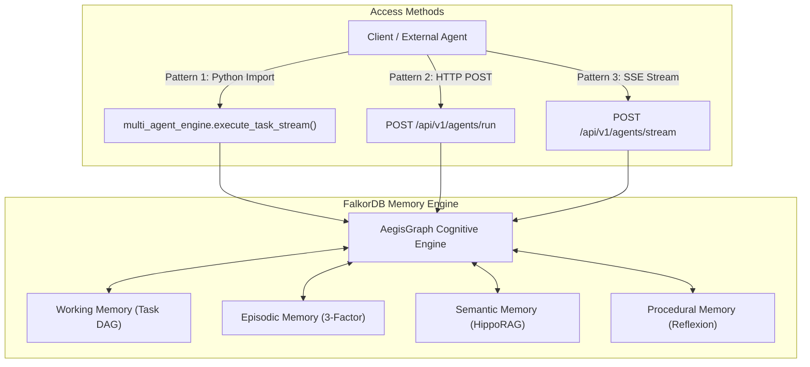

# Agent Integration Guide

This guide demonstrates how to integrate AegisGraph 4-tier cognitive memory into your own autonomous agents, backend services, or multi-agent workflows.

---

## 1. Integration Methods

AegisGraph supports three primary integration patterns:
1. **Direct Python In-Process Engine**: For native Python agents or LangGraph pipelines running inside the same application.
2. **Synchronous HTTP REST API**: For external microservices requiring standard request/response JSON payloads.
3. **Server-Sent Events (SSE) Streaming**: For real-time conversational agents, streaming progress bars, and timeline event rendering.



---

## 2. Pattern 1: Direct Python In-Process

If your agent runs in Python alongside the AegisGraph package, import `multi_agent_engine` from [`app.agents.orchestrator`](file:///home/ritwikg/Repository/agent-memory/backend/app/agents/orchestrator.py):

### 2.1 Synchronous In-Process Execution
```python
import asyncio
from app.agents.orchestrator import multi_agent_engine

async def main():
    result = await multi_agent_engine.execute_task(
        tenant_id="tenant-acme",
        session_id="session-user-123",
        user_prompt="What is our current database and what team manages it?",
        user_id="alice",
    )
    
    print(f"Status: {result['status']}")
    print(f"Task ID: {result['task_id']}")
    print(f"Answer: {result['answer']}")
    print(f"Execution Timeline ({len(result['events'])} events):")
    for event in result['events']:
        print(f" - [{event.get('phase')}] {event.get('message')}")

if __name__ == "__main__":
    asyncio.run(main())
```

### 2.2 Streaming In-Process Events
```python
import asyncio
from app.agents.orchestrator import multi_agent_engine

async def stream_agent():
    async for event in multi_agent_engine.execute_task_stream(
        tenant_id="tenant-acme",
        session_id="session-user-123",
        user_prompt="Migrate primary database to FalkorDB and enforce precautions.",
    ):
        event_type = event.get("type")
        if event_type == "agent_event":
            print(f"[{event['agent']}] {event['message']}")
        elif event_type == "episodic_retrieval_event":
            print(f"Recalled {len(event['retrieved_episodes'])} historical episodes.")
        elif event_type == "hipporag_event":
            print(f"HippoRAG active relations: {event['active_edges_count']}")
        elif event_type == "final_answer":
            print(f"\nFinal Answer: {event['answer']}\n")
        elif event_type == "error":
            print(f"Error: {event['message']}")

if __name__ == "__main__":
    asyncio.run(stream_agent())
```

---

## 3. Pattern 2: Synchronous HTTP REST API

For external clients (Go, TypeScript, Java, or remote microservices), invoke the `/api/v1/agents/run` endpoint:

### Request
```bash
curl -X POST "http://localhost:8000/api/v1/agents/run" \
  -H "Content-Type: application/json" \
  -d '{
    "prompt": "What is our production database configuration?",
    "tenant_id": "tenant-acme",
    "session_id": "session-prod-01",
    "user_id": "ops-engineer"
  }'
```

### Response
```json
{
  "task_id": "task_4f8b1a",
  "status": "SUCCESS",
  "answer": "Our production database is FalkorDB running in cloud region Asia-South1, having been migrated from PostgreSQL.",
  "duration_ms": 1420.5,
  "events": [
    {
      "type": "agent_event",
      "agent": "Orchestrator Agent",
      "phase": "plan",
      "message": "Received goal... Decomposing into Working Memory DAG..."
    },
    {
      "type": "hipporag_event",
      "agent": "Context & Triage Agent",
      "phase": "semantic_retrieval",
      "message": "HippoRAG associative recall identified 2 entity(ies)..."
    }
  ]
}
```

---

## 4. Pattern 3: Server-Sent Events (SSE) Streaming

For chat interfaces or CLI tools requiring real-time updates:

### Python `httpx` Streaming Client
```python
import httpx
import json

async def stream_remote_agent():
    url = "http://localhost:8000/api/v1/agents/stream"
    payload = {
        "prompt": "What precautions should we take for the database migration?",
        "tenant_id": "tenant-acme",
        "session_id": "session-chat-99"
    }

    async with httpx.AsyncClient(timeout=30.0) as client:
        async with client.stream("POST", url, json=payload) as response:
            async for line in response.aiter_lines():
                if line.startswith("data: "):
                    raw_data = line[6:].strip()
                    if raw_data:
                        event = json.loads(raw_data)
                        if event.get("type") == "final_answer":
                            print("\n=== ANSWER ===")
                            print(event["answer"])
                        else:
                            print(f"[{event.get('phase', 'info')}] {event.get('message')}")

if __name__ == "__main__":
    import asyncio
    asyncio.run(stream_remote_agent())
```

---

## 5. Integrating AegisGraph Memory Tools into LangChain / LangGraph

If you are building an agent with **LangChain** or **LangGraph**, you can directly expose AegisGraph's memory inspection tools to your agent's toolbelt:

```python
from langchain_core.tools import tool
from app.agents.tools import (
    query_knowledge_graph,
    search_memory_episodes,
    inspect_entity,
)

# Example: LangChain Agent Toolbelt
agent_tools = [
    query_knowledge_graph,      # Cypher read tool over the active knowledge graph
    search_memory_episodes,     # Hybrid vector + recency episode search
    inspect_entity,             # Deep-dive on entity attributes and bi-temporal edges
]

# Provide agent_tools to your LangGraph ToolNode or ChatModel.bind_tools()
```

### Available Tool Specifications

| Tool Function | Description | Parameters |
| :--- | :--- | :--- |
| `query_knowledge_graph(query_cypher, tenant_id)` | Executes parameterized read-only Cypher query against the tenant's FalkorDB graph. | `query_cypher`: OpenCypher query string<br>`tenant_id`: Tenant scope |
| `search_memory_episodes(query, tenant_id, top_k)` | Executes Park et al. 3-factor hybrid search over historical episodic memory turns. | `query`: Search text<br>`tenant_id`: Tenant scope<br>`top_k`: Max episodes to return |
| `inspect_entity(entity_name, tenant_id)` | Inspects an entity, listing active vs superseded bi-temporal relationships and provenance episodes. | `entity_name`: Entity identifier<br>`tenant_id`: Tenant scope |

---

## 6. Strict Model Availability Guarantee

In accordance with strict production requirements:
- **No Fake / Fabricated Answers**: If the configured LLM provider (e.g. Gemini, OpenAI, Anthropic) is unconfigured, unreachable, or returns an error, the agent **never fabricates mock answers**.
- **Explicit Error Propagation**:
  - SubTask 3 in Working Memory is marked as `FAILED`.
  - The API returns an explicit `status: "ERROR"`.
  - The SSE stream emits an `{"type": "error", "message": "..."}` event.
  - The failure is logged with complete provenance for debugging.
