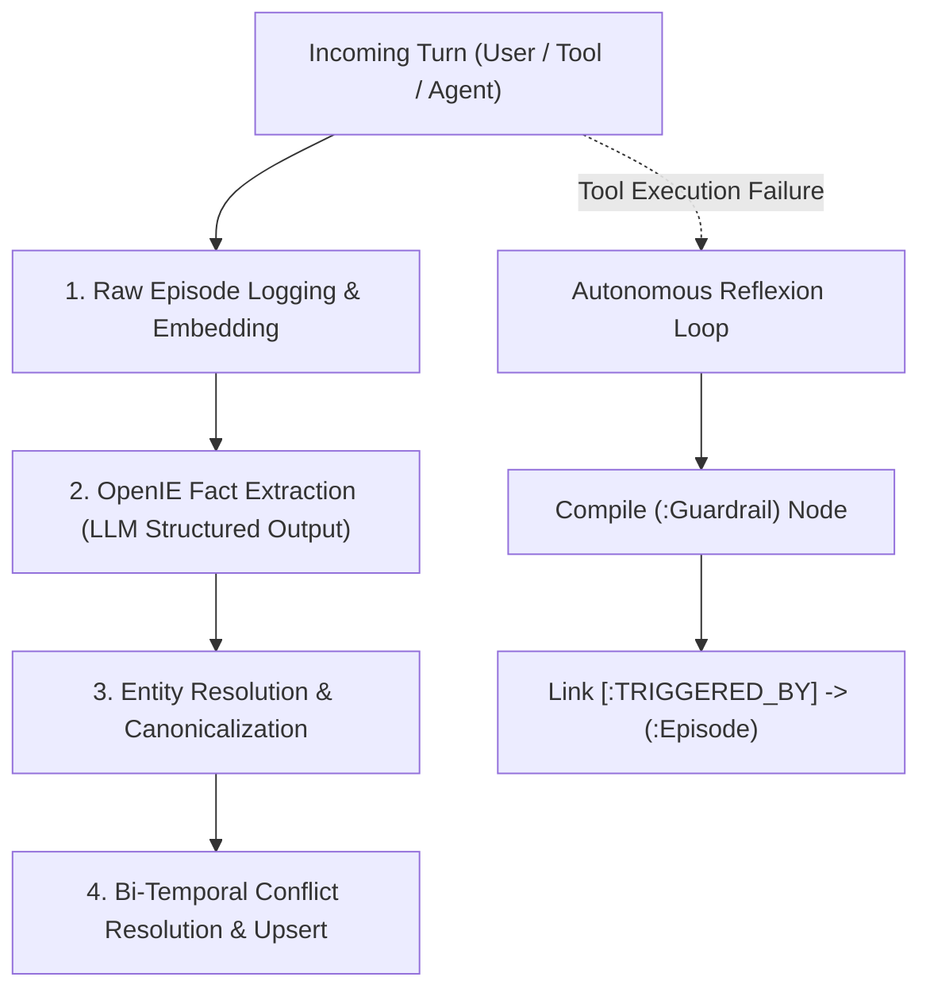

# Memory Ingestion & Extraction Architecture

Memory ingestion is the process of translating unstructured user turns, agent actions, tool outputs, and execution failures into structured, queryable FalkorDB graph structures.

AegisGraph implements an automated, multi-stage extraction pipeline:



---

## 1. Episodic Turn Ingestion

Whenever a turn occurs—whether initiated by a user, an agent, or a tool—it is immediately ingested by [`EpisodicMemoryService.record_episode()`](file:///home/ritwikg/Repository/agent-memory/backend/app/memory/episodic.py):

### 1.1 Ingestion Flow
1. **Vector Embedding**: Dense vector embeddings (768-dimensional) are generated via `embedding_service.embed_text(content)`.
2. **Importance Scoring**: The turn is evaluated to assign an initial `importance_score` $\in [0.0, 1.0]$.
3. **Atomic Append**: An atomic OpenCypher query appends the new episode to the session chain:
   ```cypher
   MERGE (s:Session {id: $session_id})
   ON CREATE SET s.created_at = $timestamp, s.episode_count = 0
   WITH s
   OPTIONAL MATCH (s)-[old_tail:SESSION_TAIL]->(prev_ep:Episode)
   DELETE old_tail
   CREATE (new_ep:Episode {
       id: $episode_id,
       session_id: $session_id,
       role: $role,
       content: $content,
       importance_score: $importance_score,
       utility_score: $importance_score,
       access_count: 0,
       timestamp: $timestamp,
       embedding: vecf32($embedding)
   })
   CREATE (s)-[:PART_OF_SESSION]->(new_ep)
   CREATE (s)-[:SESSION_TAIL]->(new_ep)
   FOREACH (_ IN CASE WHEN prev_ep IS NOT NULL THEN [1] ELSE [] END |
       CREATE (prev_ep)-[:NEXT_EPISODE]->(new_ep)
   )
   RETURN new_ep
   ```
This guarantees strict chronological ordering ($O(1)$ append time) without requiring table-wide table locks.

---

## 2. OpenIE Structured Fact Extraction

Once an episode is logged, raw conversational text is parsed to extract relational knowledge triples via [`SemanticMemoryService.extract_facts()`](file:///home/ritwikg/Repository/agent-memory/backend/app/memory/semantic.py).

### 2.1 Pydantic Extraction Schema
We leverage LLMs supporting structured outputs (e.g. `gemini-flash-lite`, `gpt-4o-mini`) enforced with strict Pydantic models:

```python
class EntityTriple(BaseModel):
    subject: str = Field(description="The source entity name, e.g. 'Primary_Database'")
    subject_type: Optional[str] = Field(default="Entity", description="Entity category, e.g. 'Database'")
    predicate: str = Field(description="Canonicalized relationship, e.g. 'USES_TECH', 'CONNECTS_TO'")
    object: str = Field(description="The target entity name, e.g. 'FalkorDB'")
    object_type: Optional[str] = Field(default="Entity", description="Target category")
    cardinality: PredicateCardinality = Field(
        default=PredicateCardinality.SINGLE,
        description="SINGLE (functional, invalidates prior) or MULTI (accumulative)"
    )
    confidence: float = Field(default=1.0, ge=0.0, le=1.0)
```

### 2.2 Canonical Predicates & Cardinality
Extraction prompts enforce consistent relationship naming to avoid graph fragmentation:
- **`USES_TECH`** (`SINGLE`): The technology a component relies on.
- **`PRIMARY_DB`** (`SINGLE`): The main database of the architecture.
- **`LOCATED_IN`** (`SINGLE`): Physical or cloud region hosting a service.
- **`CONNECTS_TO`** (`MULTI`): Network or API dependencies (systems can connect to multiple services).
- **`DEPENDS_ON`** (`MULTI`): Architectural dependencies.
- **`MANAGED_BY`** (`MULTI`): Teams or owners responsible for an entity.

---

## 3. Bi-Temporal Conflict Resolution & Upsert

Traditional knowledge bases suffer from either **catastrophic forgetting** (overwriting old facts destructively) or **hallucinatory contradiction** (storing multiple conflicting facts as concurrently true).

AegisGraph resolves this using **Bi-Temporal Edge Retirement**:

### 3.1 Single-Valued Predicates (`SINGLE`)
When a new fact with `SINGLE` cardinality arrives (e.g., `"Prod_DB USES_TECH FalkorDB"`):
1. The engine checks for existing active edges (`invalid_at IS NULL`) between the subject and any other object for that predicate.
2. If found, the old relationship is **not deleted**. Instead, its validity window is closed by setting `invalid_at = now()` and recording the invalidating episode ID.
3. The new relationship is created with `valid_at = now()` and `invalid_at = NULL`.

```cypher
MATCH (s:Entity {name: $subject})-[old_r:RELATES_TO {predicate: $predicate}]->(old_o:Entity)
WHERE old_r.invalid_at IS NULL AND old_o.name <> $new_object
SET old_r.invalid_at = $now,
    old_r.invalidated_by = $episode_id
WITH count(old_r) AS invalidated_count
MERGE (s:Entity {name: $subject})
MERGE (new_o:Entity {name: $new_object})
CREATE (s)-[new_r:RELATES_TO {
    predicate: $predicate,
    valid_at: $now,
    invalid_at: NULL,
    confidence: $confidence,
    source_episode: $episode_id
}]->(new_o)
CREATE (new_o)-[:DERIVED_FROM]->(:Episode {id: $episode_id})
RETURN invalidated_count, new_r
```

### 3.2 Multi-Valued Predicates (`MULTI`)
For relationships with `MULTI` cardinality (e.g. `CONNECTS_TO`), new relationships accumulate alongside existing active relationships without invalidation.

---

## 4. Importance & Utility Scoring

Not all interactions carry equal weight. AegisGraph combines **static LLM importance** with **dynamic runtime reinforcement**:

### 4.1 Static LLM Importance Scoring
At ingestion time, the content is scored on a $[0.0, 1.0]$ scale:
- High (0.8 - 1.0): Core architecture decisions, credentials, migration cutovers, failure post-mortems.
- Medium (0.4 - 0.7): Status updates, environment parameters, operational logs.
- Low (0.0 - 0.3): Chitchat, greetings, ephemeral acknowledgments.

### 4.2 Dynamic MemRL Utility Q-Value Updates
When a memory node $m_i$ is pinned to a working memory SubTask that completes successfully ($r = +1.0$) or fails ($r = -1.0$), its utility score is reinforced via temporal difference learning:
$$Q_{t+1}(m_i) = Q_t(m_i) + \alpha \cdot \Big( r - Q_t(m_i) \Big)$$
- Successfully utilized memories become stronger ($Q \rightarrow 1.0$).
- Misleading or irrelevant memories decay toward $0.05$.

---

## 5. Autonomous Reflexion: Failure-to-Guardrail Extraction

When tools fail during agent execution, AegisGraph captures the failure as procedural knowledge:

```python
# 1. Capture tool failure with error signature
res = run_database_migration("PostgreSQL", "FalkorDB", require_wal_checkpoint=False)

if res.get("status") == "ERROR":
    # 2. Record failure episode in Episodic Memory
    fail_ep = episodic_memory.record_episode(
        tenant_id=tenant,
        session_id=session_id,
        content=f"Tool failure in migration: {res['error_message']} (Error: {res['error_signature']})",
        role="tool",
        importance_score=0.90,
    )
    
    # 3. Compile persistent (:Guardrail) linked to the failure episode
    procedural_memory.compile_guardrail_from_failure(
        tenant_id=tenant,
        step_id="step_migration_exec",
        error_signature=res["error_signature"],
        rule_text="Always enforce require_wal_checkpoint=True during database migrations",
        fix_instruction="Set require_wal_checkpoint=True to avoid replication drift.",
        episode_id=fail_ep["id"],
    )
```

The resulting FalkorDB graph establishes full provenance:
```
(:ProcedureStep {id: 'step_migration_exec'})
    -[:HAS_GUARDRAIL]-> (:Guardrail {error_signature: 'ERR_NO_WAL_CHECKPOINT'})
        -[:TRIGGERED_BY]-> (:Episode {id: 'ep_tool_fail_123'})
```
On subsequent runs, the agent proactively queries procedural memory, identifies the guardrail, and fixes its execution parameters before ever invoking the tool.
