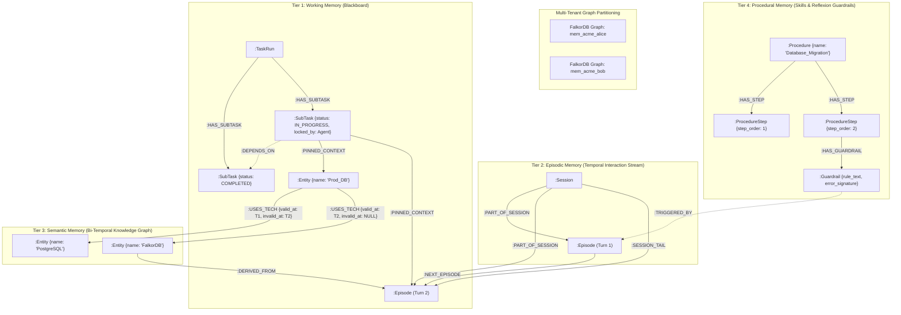

# The 4 Cognitive Memory Tiers

AegisGraph implements the **CoALA (Cognitive Architectures for Language Agents)** taxonomy on top of **FalkorDB**, separating memory into four specialized tiers: **Episodic**, **Semantic**, **Working**, and **Procedural**. Each tier has a dedicated graph schema, storage lifecycle, and mathematical retrieval model.

---

## 1. Episodic Memory

### 1.1 Purpose & Theory
Governed by research from **Generative Agents** (Park et al., Stanford, 2023) and **Zep / Graphiti** (Rasmussen et al., 2025). Episodic memory is the autobiographical, chronological log of raw interactions: user messages, agent replies, tool executions, and external events.

### 1.2 Graph Schema & Node Labels
- **`(:Session)`**: Represents a conversation session or workstream.
  - `id` (string, unique): e.g., `"sess_acme_101"`
  - `tenant_id` (string): Tenant identifier for graph routing.
  - `user_id` (string): User identifier for multi-user isolation.
  - `created_at` / `updated_at` (float): Unix epoch timestamps.
  - `episode_count` (int): Number of episodes in this session.
- **`(:Episode)`**: An individual conversational turn or event.
  - `id` (string, unique): e.g., `"ep_abc123"`
  - `session_id` (string): Parent session identifier.
  - `role` (string): `"user"`, `"agent"`, `"system"`, or `"tool"`.
  - `content` (string): Raw text payload of the turn.
  - `structured_payload` (JSON string, optional): Additional tool inputs/outputs.
  - `timestamp` (float): Creation epoch timestamp.
  - `importance_score` (float, `[0.0, 1.0]`): Baseline utility scored by LLM.
  - `utility_score` (float, `[0.05, 1.0]`): Dynamically reinforced MemRL Q-value.
  - `access_count` (int): Number of times this memory was retrieved.
  - `last_accessed` (float): Epoch timestamp of most recent recall.
  - `vcache_threshold` (float, default `0.78`): Adaptive cosine similarity boundary.
  - `embedding` (vecf32, 768-dim): Dense vector embedding for semantic search.

### 1.3 Relationships
- `(s:Session)-[:PART_OF_SESSION]->(ep:Episode)`
- `(s:Session)-[:SESSION_TAIL]->(ep:Episode)`: Pointers to the current head of the session.
- `(ep1:Episode)-[:NEXT_EPISODE]->(ep2:Episode)`: Chronological forward linkage.
- `(s1:Session)-[:PARENT_SESSION]->(s2:Session)`: Hierarchical session lineage (branching conversations).

---

## 2. Semantic Memory

### 2.1 Purpose & Theory
Governed by **HippoRAG** (Gutiérrez et al., NeurIPS 2024) and **Mem0** (Chhikara et al., 2025). While episodic memory stores raw experience, semantic memory distills experiences into structured, factual knowledge about entities, concepts, systems, and their interrelationships.

### 2.2 Bi-Temporal Validity Model
Facts change over time (e.g., *"Our primary database was PostgreSQL, but as of yesterday it is FalkorDB"*). Standard vector databases overwrite facts or suffer from contradictory context. AegisGraph implements **Bi-Temporal Edge Modeling**:
- **Transaction Time (`created_at`)**: When the fact was recorded in the graph.
- **Valid Time (`valid_at`, `invalid_at`)**: The real-world window in which the fact was true.
  - **Active belief**: `invalid_at IS NULL` (or `invalid_at > now()`).
  - **Superseded belief**: `invalid_at IS NOT NULL` (retained for audit and historical time-travel queries).

### 2.3 Graph Schema
- **`(:Entity)`**: A named real-world person, system, technology, or concept.
  - `id` (string, unique): e.g., `"ent_prod_db"`
  - `name` (string): Canonical name (e.g., `"Primary_Database"`).
  - `type` (string): Entity classification (e.g., `"Database"`, `"Service"`, `"Team"`).
  - `aliases` (list of strings): Alternative names recognized during entity resolution.
  - `embedding` (vecf32, 768-dim): Dense embedding for entity-level vector search.
- **Dynamic Predicate Edges**: `(subject:Entity)-[r:PREDICATE]->(object:Entity)`:
  - `predicate` (string): Relationship name (e.g., `USES_TECH`, `CONNECTS_TO`, `MANAGED_BY`).
  - `valid_at` (float): Unix epoch timestamp when the relation became active.
  - `invalid_at` (float, nullable): Epoch timestamp when the relation was invalidated.
  - `confidence` (float, `[0.0, 1.0]`): Extraction certainty score.
  - `cardinality` (string): `"SINGLE"` (functional, invalidates prior) or `"MULTI"` (accumulative).
- **Provenance Linkage**:
  - `(entity)-[:DERIVED_FROM]->(ep:Episode)`: Traces every fact back to the exact conversational turn that asserted it.

---

## 3. Working Memory

### 3.1 Purpose & Theory
Governed by **MemGPT** (Packer et al., UC Berkeley, 2023) and classic **Blackboard Architecture** (Nii, 1986). Working memory acts as the agent's short-term execution RAM:
1. Decomposes high-level goals into dependency DAGs of SubTasks.
2. Manages atomic claiming to prevent race conditions during multi-agent handoffs.
3. Holds explicit graph pointers (`[:PINNED_CONTEXT]`) connecting active execution tasks to long-term memory nodes.

### 3.2 Graph Schema
- **`(:TaskRun)`**: The top-level execution container for a user request.
  - `id` (string, unique): e.g., `"task_9a1f2b"`
  - `goal` (string): The user's query or instruction.
  - `status` (string): `"PENDING"`, `"IN_PROGRESS"`, `"COMPLETED"`, or `"FAILED"`.
  - `created_at` / `completed_at` (float): Timestamps.
- **`(:SubTask)`**: An individual unit of work in the decomposition DAG.
  - `id` (string, unique): e.g., `"task_9a1f2b_st1"`
  - `title` (string): Short human-readable title.
  - `description` (string): Operational objective of the step.
  - `status` (string): `"PENDING"`, `"IN_PROGRESS"`, `"COMPLETED"`, `"FAILED"`.
  - `locked_by` (string, nullable): Agent ID currently holding the atomic claim lock.
  - `claimed_at` (float, nullable): Timestamp when the lock was acquired.
  - `result_summary` (string, optional): Resulting outcome or synthesized data.
  - `reward` (float, `[-1.0, 1.0]`): Feedback score for MemRL utility reinforcement.

### 3.3 Relationships
- `(tr:TaskRun)-[:HAS_SUBTASK]->(st:SubTask)`
- `(st2:SubTask)-[:DEPENDS_ON]->(st1:SubTask)`: Defines execution wave dependencies.
- `(st:SubTask)-[:PINNED_CONTEXT {reason: string, pinned_at: float}]->(target)`: Pointers to active entities, episodes, or procedures needed during execution. Context pointers automatically propagate across dependency edges upon task completion.

---

## 4. Procedural Memory

### 4.1 Purpose & Theory
Governed by **Voyager** (Wang et al., 2023) and **Reflexion** (Shinn et al., 2023). Procedural memory stores operational knowledge: *how* tasks are done, tool execution schemas, and most importantly, **guardrails learned from past mistakes**.

### 4.2 Autonomous Reflexion Loop
When an agent invokes a tool and encounters an operational failure or domain trap:
1. The failure and its error signature (e.g., `ERR_NO_WAL_CHECKPOINT`) are logged to Episodic Memory.
2. The agent analyzes the failure and compiles a persistent `:Guardrail` node.
3. The guardrail is attached to the procedure step and linked to the failure episode via `[:TRIGGERED_BY]`.
4. On future runs, the agent proactively queries procedural memory, detects the guardrail, and fixes its parameters on the first attempt without failing.

### 4.3 Graph Schema
- **`(:Procedure)`**: A reusable multi-step workflow.
  - `id` (string, unique): e.g., `"proc_migration"`
  - `name` (string): e.g., `"Database_Migration"`
  - `trigger_description` (string): Semantic intent description used for vector matching.
  - `success_count` / `failure_count` (int): Historical track record.
- **`(:ProcedureStep)`**: An individual action within the procedure.
  - `id` (string, unique): e.g., `"step_migration_exec"`
  - `step_order` (int): 1-indexed execution sequence.
  - `tool_name` (string): Name of the underlying Python function or API tool.
  - `param_schema` (JSON string): Expected argument schema.
- **`(:Guardrail)`**: A learned behavioral constraint preventing repetition of past errors.
  - `id` (string, unique): e.g., `"gr_wal_flag"`
  - `error_signature` (string): Machine-readable failure key (e.g., `"ERR_NO_WAL_CHECKPOINT"`).
  - `rule_text` (string): Natural language constraint rule.
  - `fix_instruction` (string): Exact remediation instructions.
  - `created_at` (float): Timestamp of Reflexion compilation.

### 4.4 Relationships
- `(p:Procedure)-[:HAS_STEP]->(s:ProcedureStep)`
- `(s:ProcedureStep)-[:HAS_GUARDRAIL]->(g:Guardrail)`
- `(g:Guardrail)-[:TRIGGERED_BY]->(ep:Episode)`: Provenance linking the guardrail to the historical failure episode.

---

## 5. Multi-Tenant Graph Isolation

In enterprise environments, data leakage between tenants or users is unacceptable. AegisGraph guarantees hardware-level isolation by utilizing FalkorDB's native multi-graph architecture:
- Every tenant and user maps to a distinct FalkorDB graph namespace:
  $$\text{Graph Key} = \text{mem\_} + \text{tenant\_id} + \text{\_} + \text{user\_id}$$
  *(e.g., `mem_acme-corp_alice` vs `mem_globex_bob`).*
- Cypher queries are automatically routed to the caller's graph namespace. Cross-tenant reads or writes are physically impossible at the database engine level.
