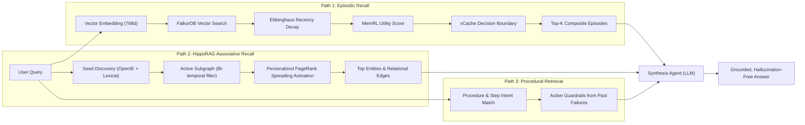

# Dual-Path Retrieval Architecture

Standard retrieval-augmented generation (RAG) relies almost entirely on top-K dense vector cosine similarity over flat text chunks. In real-world enterprise agent scenarios, this fails across three critical dimensions:
1. **Temporal Blindness**: Vector similarity cannot distinguish between what was true six months ago and what was decided yesterday.
2. **Multi-Hop Disconnection**: Concepts connected through intermediate relationships (e.g., *Service A depends on DB B, which is maintained by Team C*) are missed unless both appear in the same chunk.
3. **Repeated Mistakes**: Agents repeat known tool parameter errors because past operational failures are not retrieved before actions are taken.

AegisGraph solves these challenges using a **Dual-Path Cognitive Retrieval Architecture**:
- **Chronological / Experiential Pathway**: Park et al. 3-factor Episodic Recall.
- **Relational / Knowledge Pathway**: HippoRAG Associative Graph Walks via Personalized PageRank.
- **Operational / Safety Pathway**: Procedural Guardrail Matching.



---

## 1. Episodic Retrieval: Park et al. 3-Factor Composite Model

*Governed by Park et al. (Stanford, 2023), MemoryBank (Zhong et al., 2024), and vCache (Schroeder et al., 2026).*

Episodic recall balances three distinct forces: **Recency**, **Utility/Importance**, and **Relevance**.

### 1.1 The Composite Formula
For every candidate episode node $e$, its composite score is calculated as:

$$\text{Composite Score}(e) = \frac{\alpha \cdot S_{\text{recency}}(e) + \beta \cdot S_{\text{utility}}(e) + \gamma \cdot S_{\text{relevance}}(e)}{\alpha + \beta + \gamma}$$

Default hyperparameters: $\alpha = 1.0, \beta = 1.0, \gamma = 1.0$.

---

### 1.2 Factor 1: Recency ($S_{\text{recency}}$)
Recency implements an **Ebbinghaus exponential forgetting curve**, reinforced by retrieval frequency (`access_count`):

$$S_{\text{recency}}(e) = \exp\left( - \frac{\lambda \cdot \Delta t}{\text{access\_count} + 1} \right)$$

- $\Delta t = t_{\text{now}} - t_{\text{last\_accessed}}$ (in seconds).
- $\lambda = 0.0001925$ (half-life of approximately 1 hour under zero access).
- As an episode is repeatedly recalled, its effective decay rate slows down, mirroring human long-term memory consolidation.

---

### 1.3 Factor 2: Utility & Importance ($S_{\text{utility}}$)
Utility reflects the intrinsic value of the memory:
- **Baseline**: Static importance score assessed at ingestion time $[0.0, 1.0]$.
- **Reinforced Q-Value**: Dynamically updated by task outcome rewards ($r = \pm 1.0$) via temporal-difference learning:
  $$Q_{t+1}(e) = Q_t(e) + \alpha_{\text{RL}} \cdot \big( r - Q_t(e) \big)$$
  Memories that consistently help resolve user queries maintain high utility scores even as time elapses.

---

### 1.4 Factor 3: Semantic Relevance & vCache Thresholding ($S_{\text{relevance}}$)
Candidate episodes are retrieved via FalkorDB's native HNSW vector index:
```cypher
CALL db.idx.vector.queryNodes('Episode', 'embedding', $candidate_limit, vecf32($query_vec))
YIELD node AS ep, score AS distance
WITH ep, (1.0 - distance) AS cosine_sim
RETURN ep, cosine_sim
```

To prevent noisy, hallucinated retrievals, each memory maintains an adaptive **vCache decision threshold** $\tau_e$ (default `0.78`):
- If $\text{cosine\_sim} \ge \tau_e$, the memory passes at full relevance strength.
- If $\text{cosine\_sim} < \tau_e$, its relevance is heavily penalized ($\times 0.5$) or pruned:
  $$S_{\text{relevance}}(e) = \begin{cases} \text{cosine\_sim} & \text{if } \text{cosine\_sim} \ge \tau_e \\ \text{cosine\_sim} \times 0.5 & \text{otherwise} \end{cases}$$

Upon query completion, $\tau_e$ self-calibrates: if the memory contributed to success, $\tau_e \leftarrow \tau_e - 0.02$ (widening the recall boundary); if it contributed to failure, $\tau_e \leftarrow \tau_e + 0.05$ (tightening the boundary).

---

## 2. Semantic Retrieval: HippoRAG Associative Spreading Activation

*Governed by HippoRAG (Gutiérrez et al., OSU, NeurIPS 2024).*

HippoRAG models the human neocortex-hippocampus interaction: instead of searching for arbitrary text passages, it identifies named **seed entities** and computes **Personalized PageRank (PPR)** over the active knowledge graph.

### 2.1 Step 1: Hybrid Seed Discovery
Seeds are discovered via two simultaneous mechanisms:
1. **Lexical & Entity Resolution**: Extracted entities from user input matched against canonical names and aliases in FalkorDB.
2. **Vector Entity Matching**: Finding semantic matches in the `Entity` vector index:
   ```cypher
   CALL db.idx.vector.queryNodes('Entity', 'embedding', 5, vecf32($query_vec))
   YIELD node AS ent, score AS distance
   RETURN ent.name AS seed, (1.0 - distance) AS weight
   ```

---

### 2.2 Step 2: Active Subgraph Expansion with Bi-Temporal Filtering
From the seed set $S$, FalkorDB expands outward up to $k$-hops (default $k = 2$), discarding invalidated relationships:

```cypher
MATCH (src:Entity)
WHERE src.name IN $seed_names
MATCH path = (src)-[r*1..2]-(tgt:Entity)
WHERE ALL(rel IN relationships(path) WHERE
    rel.valid_at <= $as_of AND
    (rel.invalid_at IS NULL OR rel.invalid_at > $as_of)
)
RETURN startNode(rel) AS source, type(rel) AS predicate, endNode(rel) AS target, rel.confidence AS weight
```
This guarantees that historical or retracted facts (e.g., an obsolete database technology) are excluded from the active traversal graph.

---

### 2.3 Step 3: Personalized PageRank (PPR) Spreading Activation
Given an undirected graph of active nodes $V$ and edges $E$, an initial restart probability vector $\mathbf{p}_0$ is constructed using normalized seed confidence scores:

$$\mathbf{p}_0(u) = \begin{cases} \frac{\text{score}(u)}{\sum_{s \in S} \text{score}(s)} & \text{if } u \in S \\ 0 & \text{otherwise} \end{cases}$$

Power iteration is executed with damping factor $\alpha = 0.85$:

$$\mathbf{\pi}^{(t+1)} = (1 - \alpha) \cdot \mathbf{p}_0 + \alpha \cdot \mathbf{M} \mathbf{\pi}^{(t)}$$

where $\mathbf{M}$ is the column-normalized adjacency transition matrix.

To avoid popularity bias where high-degree hub nodes dominate, scores are **degree-normalized**:

$$\mathbf{\pi}_{\text{norm}}(u) = \frac{\mathbf{\pi}(u)}{\log(1 + \text{deg}(u))}$$

Entities are ranked according to $\mathbf{\pi}_{\text{norm}}$.

---

### 2.4 Step 4: Bipartite Grounded Episode Retrieval
Finally, HippoRAG traverses from top-ranked entities back to their originating historical turns via `[:DERIVED_FROM]`, identifying the exact episodes that established those facts:

$$\text{Grounded Score}(\text{ep}) = \sum_{e \in \text{Entities}(\text{ep})} \mathbf{\pi}_{\text{norm}}(e)$$

---

## 3. Procedural Guardrail Retrieval

When an agent plans to execute a workflow or tool call:
1. Procedural memory queries existing `(:Procedure)` and `(:ProcedureStep)` nodes matching the target tool name.
2. It expands any attached `[:HAS_GUARDRAIL]` nodes:
   ```cypher
   MATCH (p:Procedure {name: $procedure_name})-[:HAS_STEP]->(s:ProcedureStep)-[:HAS_GUARDRAIL]->(g:Guardrail)
   RETURN g.error_signature AS error_sig, g.rule_text AS rule, g.fix_instruction AS fix
   ```
3. If an active guardrail exists, the agent injects the `fix_instruction` directly into the tool parameters before the initial execution, preventing repeat exceptions.

---

## 4. Synthesis Prompt Grounding

Once retrieved, the orchestrator compiles the memories into a single context payload:

```text
RECALLED EPISODIC INTERACTIONS:
- [user]: What is our current database?
- [agent]: As of our last migration, we cut over to FalkorDB on port 50891.

RECALLED SEMANTIC ENTITIES:
- Primary_Database (type: Database)
- FalkorDB (type: Technology)

ACTIVE KNOWLEDGE GRAPH RELATIONS:
- Primary_Database -[USES_TECH]-> FalkorDB
- Primary_Database -[HOSTED_ON]-> Google Cloud Platform

OPERATIONAL ACTION RESULTS:
- Procedural check confirmed: require_wal_checkpoint=True enforced.
```

The LLM receives this structured context and generates an accurate, hallucination-free response grounded directly in enterprise memory.
